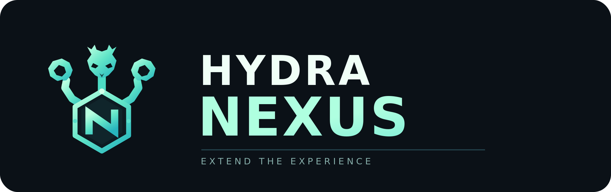
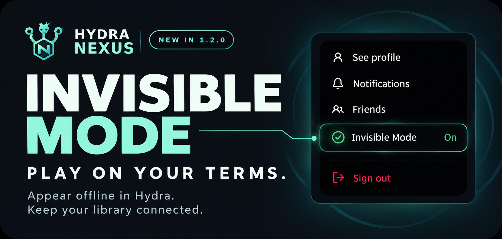
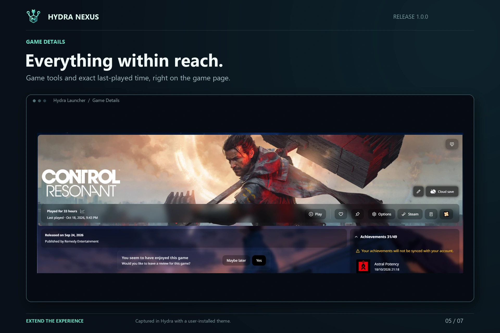
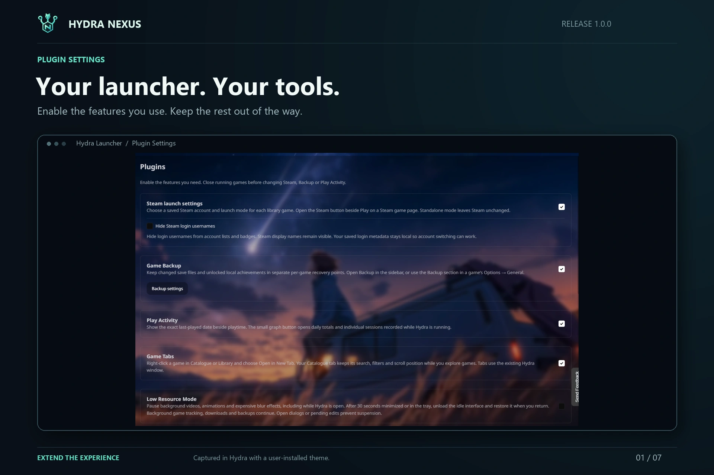
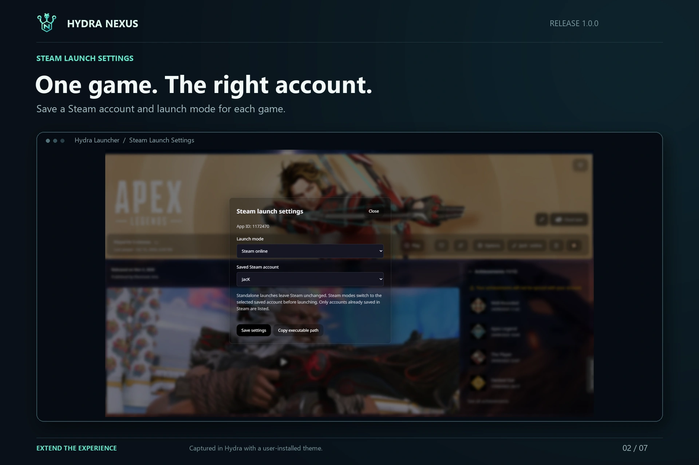
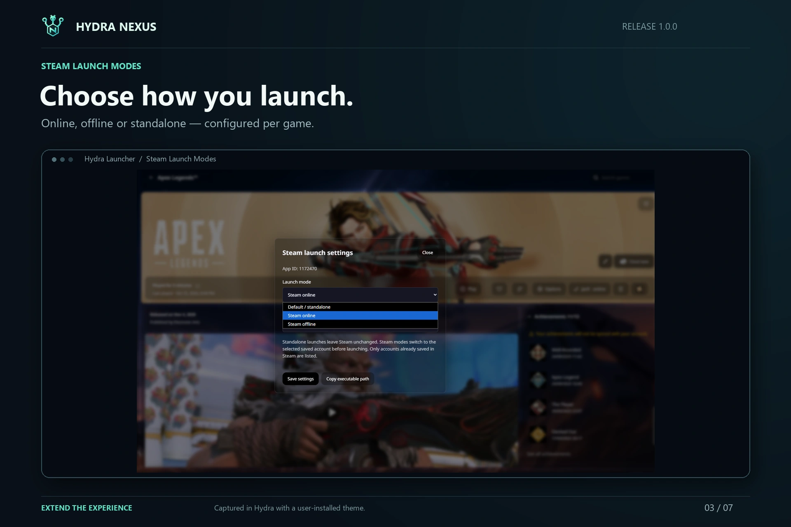
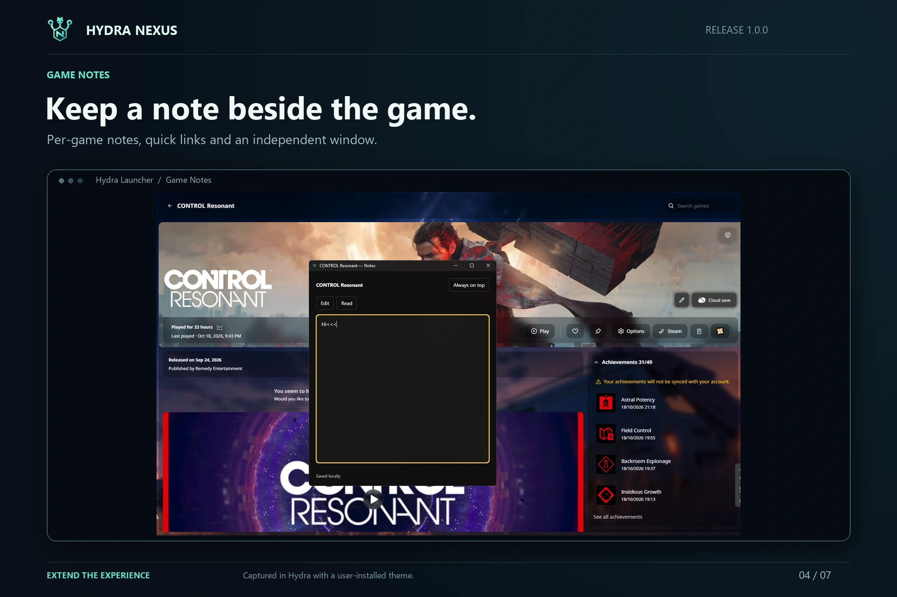
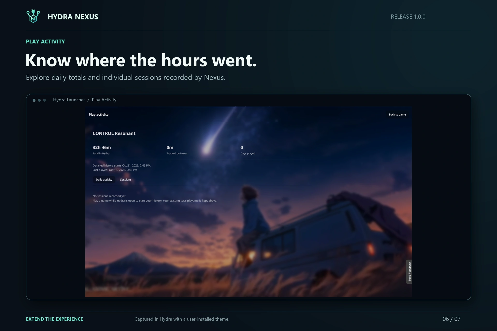
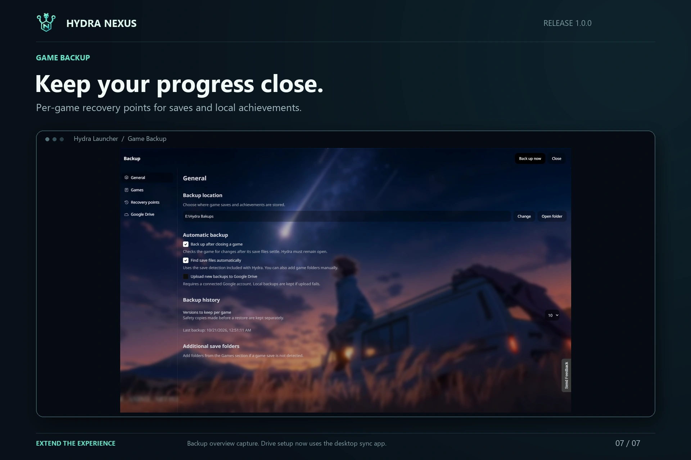

<p align="center"></p>

<p align="center">
  <a href="https://github.com/M0KA40/Hydra-Nexus/releases/latest"></a>
  
  <a href="LICENSE"></a>
</p>

**A community patch for Hydra Launcher. Requires an existing Hydra Launcher installation; this is not a standalone launcher.**

Hydra Nexus adds game tools to Hydra Launcher: backups, notes, tabs, play history, Steam launch settings and more. Features live in Hydra's settings and game pages, with controls that follow your installed theme.

**Hydra Nexus 1.2.0** adds English, Português (Brasil), Español, Русский, العربية, Français, Deutsch and Türkçe. Nexus follows Hydra's chosen language, switches live and falls back to English for unsupported languages. [Language support and contribution rules](docs/localization.md).

**[Download the installer](https://github.com/M0KA40/Hydra-Nexus/releases/latest/download/Hydra_Nexus.bat)** · [Installation](docs/installation.md) · [Feature guide](docs/features.md) · [Report a problem](https://github.com/M0KA40/Hydra-Nexus/issues/new/choose)

## Invisible Mode — play on your terms

<p align="center"></p>

**New in 1.2.0.** Control your Hydra presence while game images, local progress and your interface stay available. Enable the plugin, then switch Invisible Mode on below **Friends** in your account menu.

**One-click control · Clear on/off status · Your existing Hydra theme**

[How Invisible Mode works](docs/invisible-mode.md) · [1.2.0 release notes](docs/releases/1.2.0.md)

## Install

1. Download **Hydra_Nexus.bat** from Releases.
2. Exit Hydra completely, including its tray icon.
3. Run the BAT and choose **Install / Update / Repair**.
4. Open **Hydra → Settings → Hydra Nexus → Plugins**.

The installer includes its runtime. You do not need Node.js or Python. Optional cloud copies require Google Drive for desktop. Updating keeps your settings, notes, play history and game backups.

## What's included

| Feature | What it does | Where to use it |
| --- | --- | --- |
| **Game Backup** | Keeps separate recovery points for each game's saves and local achievements. Supports external restore and optional copies through Google Drive for desktop. | Backup in the sidebar; game Options → General |
| **Game Notes** | Saves text and links for each game in a portable local file. The separate window supports Always on top and a keyboard shortcut. | Notes button beside Play |
| **Game Tabs** | Opens games from Catalogue or Library without losing your catalogue search, filters and scroll position. | Right-click a game → Open in New Tab |
| **Play Activity** | Shows the exact last-played date and a record of daily playtime and sessions. | Date and activity icon beside playtime |
| **Invisible Mode** | Enable its account-menu control in Plugins, then independently turn privacy on/off below Friends. Preserves image/interface access and private activity holds. | Plugins/account menu; [behavior and limits](docs/invisible-mode.md) |
| **Steam** | Chooses a saved Steam account and online, offline or standalone launch mode per game. Login usernames can be hidden. | Steam button beside game actions |
| **Nexus Mods** | Opens a matched game's mods page. Edition names are normalized; unmatched games open a game search. | Nexus Mods logo on library game pages |
| **PC Compatibility** | Compares your confirmed PC specifications with published minimum requirements. Supported CPU/GPU models use benchmark references. | Monitor icon on a game's cover |
| **Low Resource Mode** | Pauses background video and visual effects. | Plugins |
| **Custom Backgrounds** | Applies a local image or video over your theme's background. Includes darkness, blur and reset controls. | Themes |
| **Updater** | Checks GitHub releases and offers a verified download, installation and restart. Automatic checks can be disabled. | Updater |

Read the [feature guide](docs/features.md) for controls, setup and limitations.

## A look inside



<details open>
<summary>Plugin settings and Steam launch controls</summary>





</details>

<details>
<summary>Notes, play history and backups</summary>





The Backup screenshot predates the desktop-sync update. The current Google Drive page uses a folder picker, not a Google account connection.

</details>

The screenshots show the extension with a Hydra theme. Themes are not included in the download.

## Before you start

- **Backups:** a game needs actual save files or local achievement data. Adding a title to your library does not create a save backup. Restoring local achievements does not grant Steam or Epic account unlocks.
- **Play history:** detailed sessions start when Nexus tracking is enabled. Earlier daily records cannot be recovered from a lifetime total.
- **PC checks:** results estimate minimum suitability. They do not predict FPS. Missing publisher requirements or unsupported hardware ratings are identified in the result.
- **Compatibility:** verified against Hydra 4.2.0 on Windows. There is no version whitelist, but Hydra updates can change internal interfaces and require a Nexus update. Re-run the installer after a Hydra update replaces the patch.

## Project information

**1.2.0 — Invisible Mode & multilingual update** brings private presence controls, eight interface languages, reliable Steam switching from existing Desktop shortcuts and a repaired in-app updater. [Read the patch notes](docs/releases/1.2.0.md).

**1.0.1 — Maintenance update** fixes unnecessary UI work, Steam activation, Notes, Backup navigation and installer/update handling. [Read the patch notes](docs/releases/1.0.1.md).

**1.0.0 — First Release** includes all eight plugins, desktop Drive sync and the in-app updater. Earlier 2.x development builds need one manual installation of 1.0.0. Subsequent 1.x releases update through Updater. GameShift, achievement-style imports and theme CSS editing are not included.

Hydra Nexus is a community project, independent of Hydra Launcher, Valve, Google and Nexus Mods. Development continues; please include steps to reproduce a problem when opening an issue.

[Privacy](docs/privacy.md) · [Troubleshooting](docs/troubleshooting.md) · [Verification](docs/verification.md) · [Changelog](CHANGELOG.md) · [Contributing](CONTRIBUTING.md) · [Third-party notices](THIRD_PARTY_NOTICES.md)

## Build from source

```sh
python build.py
```

The build writes `Hydra_Nexus.bat` to `dist/`. No Google OAuth configuration is required. See [contributing](CONTRIBUTING.md) for the source layout and checks.

