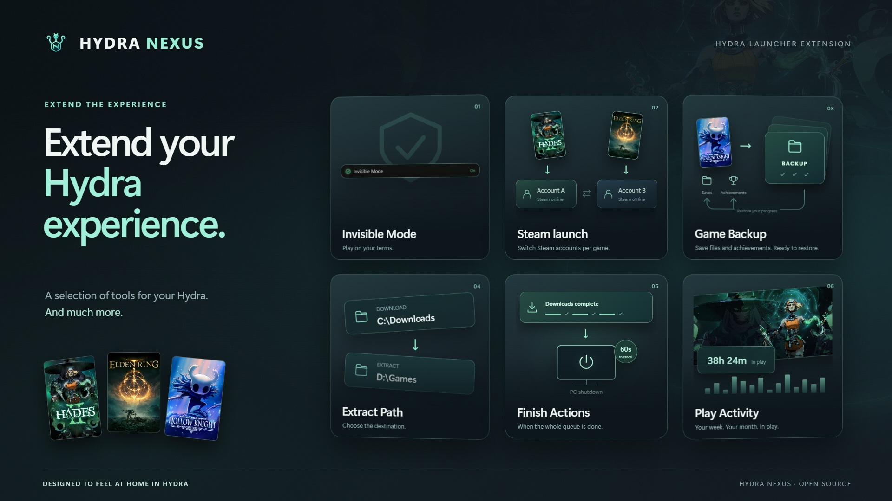
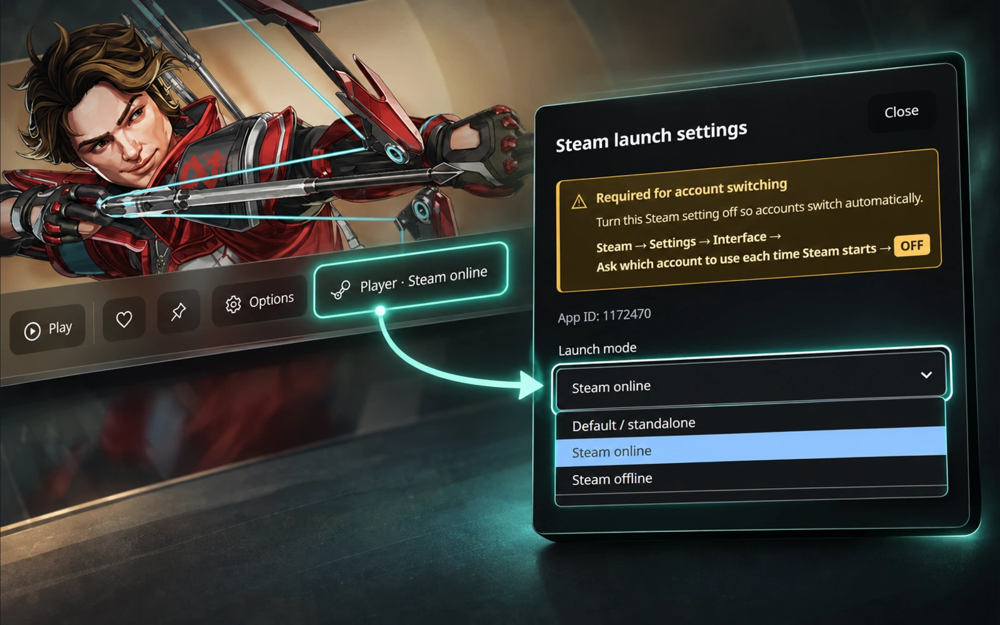
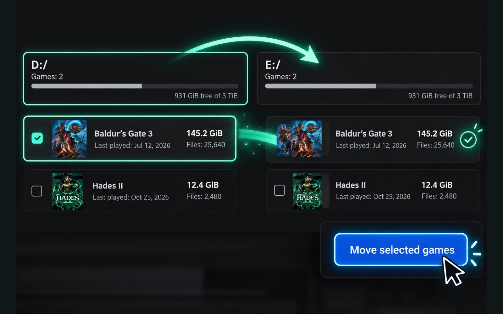
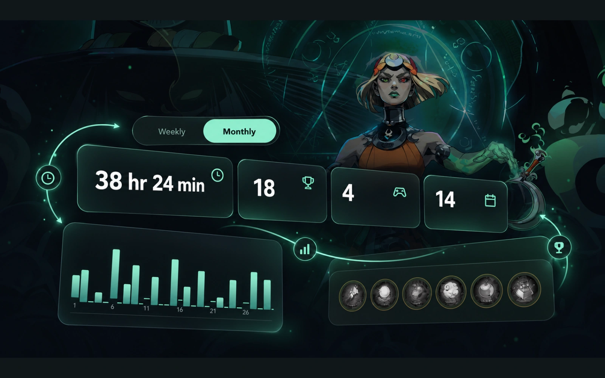
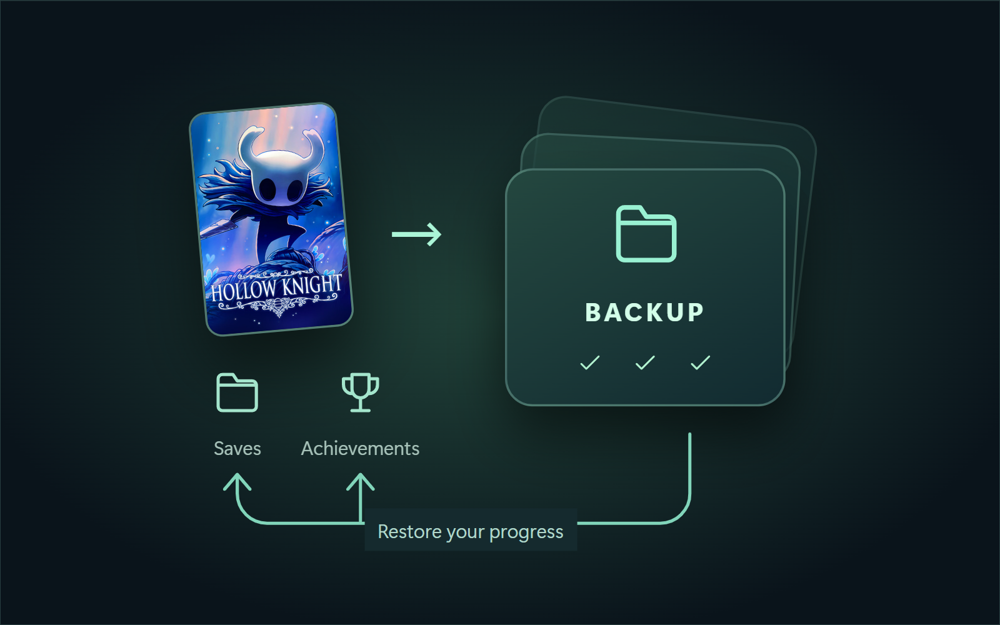
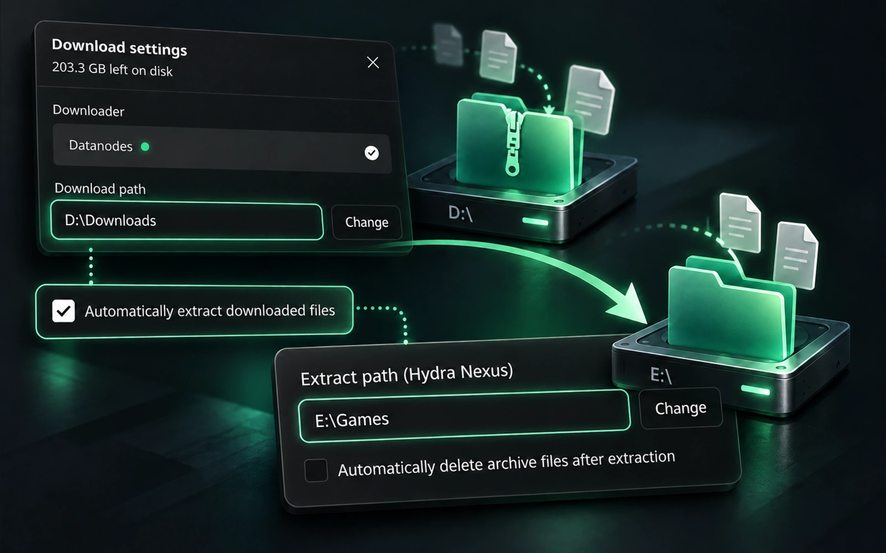
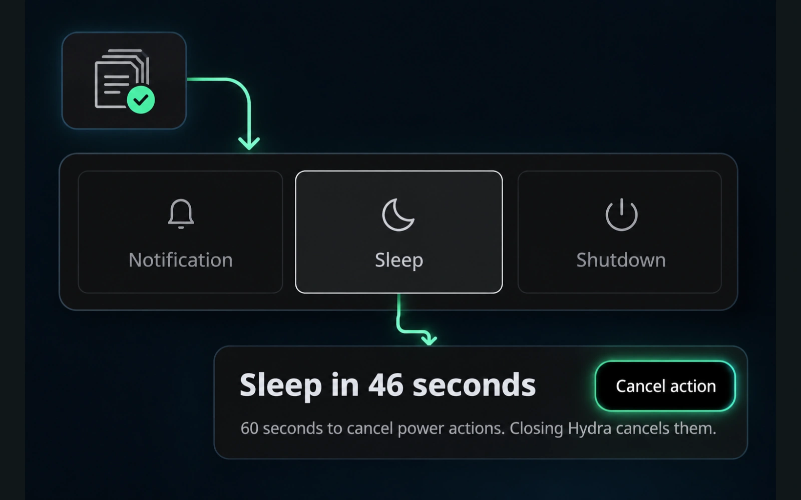
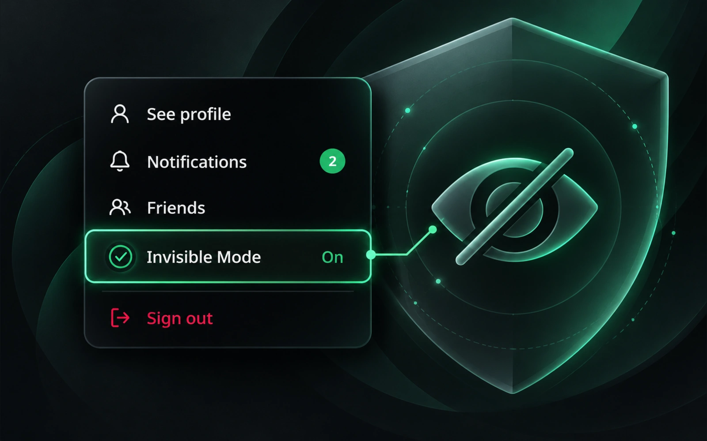
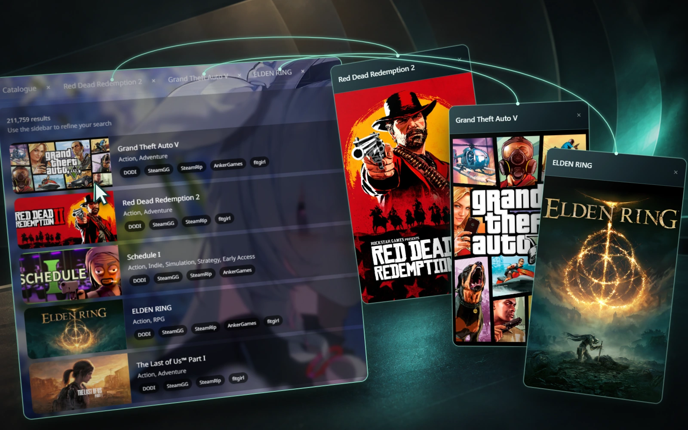

[English](../../README.md) · [Português (Brasil)](pt-BR.md) · [Español](es.md) · [Русский](ru.md) · [العربية](ar.md) · [Français](fr.md) · [Deutsch](de.md) · [Türkçe](tr.md) · [Polski](pl.md)

# Hydra Nexus

Hydra Nexus إضافة مجتمعية لهايدرا لانشر على ويندوز. تضيف أدوات لتخزين الألعاب، ونسخ الحفظ والإنجازات المحلية، وحساب Steam لكل لعبة، ونشاط اللعب والتبويبات والملاحظات وخلفياتك الخاصة. فعّل الأدوات التي تحتاجها من Plugins. تتبع الواجهة لغة هايدرا وتستخدم عناصره الأصلية لتتناسب مع الثيم. يلزم وجود تثبيت Hydra Launcher مسبقًا.

**[تحميل المثبت](https://github.com/M0KA40/Hydra-Nexus/releases/latest/download/Hydra_Nexus.bat)** · [ملاحظات الإصدار](../../docs/releases/2.0.0/ar.md) · [الإبلاغ عن مشكلة](https://github.com/M0KA40/Hydra-Nexus/issues/new/choose)

## Steam launch settings



اربط كل لعبة بحساب Steam محفوظ ووضع تشغيل مناسب. Default / standalone يشغّل اللعبة دون طلب تشغيل Steam أو تبديل حسابه من Nexus؛ جلسة Steam المفتوحة تبقى كما هي. Steam online للحساب الشخصي المتصل، وSteam offline يفرض عدم الاتصال للحساب المحدد، بما فيه الحسابات المشتركة. تظهر الحسابات المحفوظة في Steam فقط. عطّل سؤال اختيار الحساب عند بدء Steam للسماح بالتبديل التلقائي.

**مكان الاستخدام:** المكتبة ← صفحة اللعبة ← زر Steam بجانب التشغيل

## Game Storage Manager



اعرض الألعاب المثبّتة حسب القرص والمساحة المتاحة وأحجام الملفات المقاسة. ابحث ورتّب حسب الحجم أو آخر تشغيل. افتح مجلد اللعبة أو انقل ألعابًا محددة بعد مراجعة الوجهة والمساحة المطلوبة. يُتحقّق من الملفات المنسوخة قبل تحديث المسارات وحذف الأصل. المجلدات غير المؤكدة تحتاج تأكيدًا والفحوص الجزئية مميّزة. لا يعاد تعديل اختصارات سطح المكتب أو تسجيلات المشغّلات الخارجية.

**مكان الاستخدام:** الإعدادات ← أسفل Big Picture ← Game Storage Manager

## Play Activity



استعرض جلسات كل لعبة ووقت اللعب وتاريخ آخر لعب. تعرض الملخصات الأسبوعية والشهرية الألعاب وأيام النشاط والإنجازات المؤرّخة المتاحة. تحكّم بالإشعارات من الجرس، أو عطّل الملخصات وإشعاراتها مع إبقاء تتبّع الجلسات وسجل اللعبة. يبدأ السجل التفصيلي عندما يتتبع Nexus اللعب؛ الإجمالي القديم لا يعيد بناء الجلسات السابقة.

**مكان الاستخدام:** الشريط الجانبي ← Play activity؛ رسم النشاط بجانب وقت اللعبة

## Game Backup



احتفظ بنقاط استرجاع منفصلة لحفظ كل لعبة وإنجازاتها المحلية. استرجع نسخة أو افتح مجلدها أو استخرج نسخة موثقة إلى مكان آخر دون استبدال الحفظ الحالي. أضف مجلد حفظ إضافيًا أو أوقف النسخ الجديدة للعبة مع إبقاء سجلها. للنسخ السحابي اختر مجلدًا يزامنه Google Drive للكمبيوتر؛ يتولى Drive المزامنة دون تسجيل Google داخل Nexus. أغلق الألعاب قبل الاسترجاع. استرجاع الإنجازات المحلية لا يفتح إنجازات حساب Steam أو Epic.

**مكان الاستخدام:** الشريط الجانبي ← Backup؛ خيارات اللعبة ← General ← Backup

## Extract Path



حمّل الأرشيفات على قرص وفك ضغط اللعبة على قرص آخر. فعّل الاستخراج التلقائي في إعدادات التنزيل واختر Extract path. يتذكر Nexus آخر وجهة مقبولة ويحفظ وجهة كل تنزيل في القائمة، مع إنشاء مجلد للعبة داخلها. تبقى الأرشيفات في موقع التنزيل للاستكمال والمشاركة ما لم تفعّل حذفها بعد الاستخراج بشكل منفصل.

**مكان الاستخدام:** إعدادات التنزيل ← الاستخراج التلقائي ← Extract path

## Download Finish Actions



اختر إشعارًا أو السكون أو إغلاق الكمبيوتر بعد اكتمال قائمة التنزيلات وعمليات فك الضغط المفعّلة. لإجراءات الطاقة مهلة 60 ثانية للإلغاء. التنزيلات الجديدة تعيد الانتظار وإغلاق هايدرا يلغي الإجراء. تفعيل البلغن يحتاج إعادة تشغيل هايدرا، ولا تفعّل إعادة التشغيل إجراء طاقة تلقائيًا.

**مكان الاستخدام:** التنزيلات ← بجانب Cancel ← Download Finish Actions

## Invisible Mode



تحكّم بمشاركة النشاط مع هايدرا مع إبقاء التقدم المحلي وصور الألعاب. تفعيل البلغن يشغّل Invisible Mode مباشرة، ويمكنك تغييره لاحقًا من قائمة الحساب. يبقى النشاط الخاص محليًا بعد إيقاف الوضع حتى تستأنف مشاركته صراحة. قد تتأخر تحديثات الظهور، وإشعارات الألعاب تعتمد أيضًا على خوادم هايدرا.

**مكان الاستخدام:** قائمة الحساب ← أسفل Friends ← Invisible Mode

## Game Tabs



افتح صفحات ألعاب متعددة في تبويبات داخل نافذة هايدرا، وارجع إلى مكانك. تُحفظ نتائج بحث الكتالوج والفلاتر والتمرير. اضغط بزر الماوس الأيمن على لعبة في الكتالوج أو المكتبة واختر Open in New Tab؛ تنقّل من شريط التبويبات وأغلق بعلامة ×. التبويبات تخص الجلسة الحالية ولا تُستعاد بعد إغلاق البرنامج بالكامل.

**مكان الاستخدام:** الكتالوج أو المكتبة ← كليك يمين ← Open in New Tab

## Custom backgrounds

https://github.com/user-attachments/assets/f69ff1b4-6250-43b1-a5d7-98ca3722d952

اختر صورة أو فيديو محليًا كخلفية لهايدرا. اضبط التعتيم والتمويه، وأوقف الفيديو اختياريًا عند عدم نشاط هايدرا، وأعد خلفية الثيم بزر إعادة التعيين. تشغيل الفيديو يعتمد على الترميز؛ يوصى بـH.264 MP4 أو WebM.

**مكان الاستخدام:** إعدادات Hydra Nexus ← Themes ← اختيار صورة أو فيديو

## أدوات إضافية

- Game Notes — نصوص وروابط لكل لعبة ونافذة مستقلة وخيار البقاء فوق النوافذ واختصار للتركيز.
- Nexus Mods — افتح صفحة مودات اللعبة المطابقة أو ابحث عند غياب مطابقة موثوقة.
- PC Compatibility — قارن مواصفات جهازك المؤكدة بالمتطلبات الدنيا المنشورة. التقدير ليس توقعًا لعدد الإطارات.
- Updater — تحقق من الإصدارات وبصمة المثبت وحدّث هايدرا وأعد تشغيله.

## لغات الواجهة المدعومة

| اللغة | اسمها الأصلي | واجهة Nexus |
| --- | --- | --- |
| en | English | ✓ مدعومة |
| pt-BR | Português (Brasil) | ✓ مدعومة |
| es | Español | ✓ مدعومة |
| ru | Русский | ✓ مدعومة |
| ar | العربية | ✓ مدعومة |
| fr | Français | ✓ مدعومة |
| de | Deutsch | ✓ مدعومة |
| tr | Türkçe | ✓ مدعومة |
| pl | Polski | ✓ مدعومة |

## التثبيت والتحديث

1. حمّل Hydra_Nexus.bat من الإصدارات.
2. أغلق هايدرا بالكامل، بما في ذلك أيقونة شريط المهام.
3. شغّل BAT واختر Install / Update / Repair.
4. افتح Hydra ← Settings ← Hydra Nexus ← Plugins.

لا تحتاج تثبيت Node.js أو Python لتشغيل المثبت. التحديث يحافظ على الإعدادات والملاحظات وسجل اللعب والنسخ الاحتياطية. إذا استبدل تحديث هايدرا التعديلات، أعد تطبيق نسخة Nexus متوافقة. Nexus مستقل عن Hydra Launcher وValve وGoogle وNexus Mods. أرفق إصداري البرنامجين وخطوات إعادة المشكلة عند الإبلاغ.

## معلومات إضافية

[Privacy](../../docs/privacy.md) · [Troubleshooting](../../docs/troubleshooting.md) · [Changelog](../../CHANGELOG.md) · [Contributing](../../CONTRIBUTING.md) · [MIT](../../LICENSE) · [Third-party notices](../../THIRD_PARTY_NOTICES.md)

## البناء من المصدر

```sh
python build.py
```

