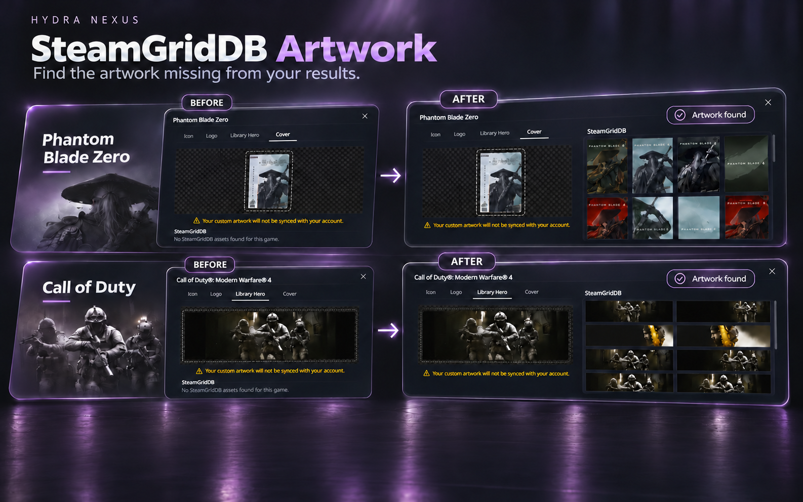

[English](../../README.md) · [Português (Brasil)](pt-BR.md) · [Español](es.md) · [Русский](ru.md) · [العربية](ar.md) · [Français](fr.md) · [Deutsch](de.md) · [Türkçe](tr.md) · [Polski](pl.md)

# Hydra Nexus

Hydra Nexus ist eine Community-Erweiterung für Hydra Launcher unter Windows. Entdecke Nexus Discovery, neue Erfolgsbenachrichtigungen, einen Veröffentlichungskalender für deine Bibliothek, lokale und Cloud-Backups, Steam-Konten pro Spiel, Spielaktivität, Speicherwerkzeuge, Tabs, Notizen und eigene Hintergründe. Aktiviere die gewünschten Werkzeuge unter Plugins. Nexus folgt der Sprache von Hydra und passt sich deinem Theme an. Hydra Launcher muss bereits installiert sein.

**[Installer herunterladen](https://github.com/M0KA40/Hydra-Nexus/releases/latest/download/Hydra_Nexus.exe)** · [Versionshinweise](https://github.com/M0KA40/Hydra-Nexus/releases/latest) · [Problem melden](https://github.com/M0KA40/Hydra-Nexus/issues/new/choose)

## Nexus Discovery


**Dein Hydra-Erlebnis, neu gestaltet.**

Nexus Discovery gestaltet Hydra von der Startseite bis zu den Spieldetails neu. Die Startseite zeigt vier der aktivsten Steam-Spiele in einer filmischen Präsentation, ergänzt durch Neuerscheinungen und Empfehlungen auf Basis deiner Bibliothek. Überarbeitete Katalog- und Bibliotheksansichten, dezente Glaseffekte auf Spielcovern und flüssige Übergänge geben dem Stöbern einen neuen Look.

Spielseiten gliedern Inhalte in Übersicht, Updates, Über das Spiel, Community und Details, einschließlich Entwicklernachrichten und Patchnotes von Steam. Downloads rücken Spielgrafik und Fortschritt in den Mittelpunkt. Die überarbeitete Spielaktivität und die Statistiken pro Spiel zeigen Spiele, Spielzeit, aktive Tage und Sitzungen; Wochen- und Monatsrückblicke passen sich deinem Theme an.

**Hier verwenden:** Einstellungen → Hydra Nexus → Themes; Optionen für Erfolgsbenachrichtigungen in den Einstellungen.

### Erfolgsbenachrichtigungen

Das neue Nexus-Discovery-Design bringt einen eigenen Look und neue Animationen für normale, versteckte, seltene und Platin-Erfolge. Wechsle in den Einstellungen zwischen Nexus und den ursprünglichen Hydra-Benachrichtigungen, passe den Ton an und nutze **Benachrichtigung testen** für eine Vorschau.

https://github.com/user-attachments/assets/a7789265-e442-4427-bd9e-e83d93fac86e

## Steam-Startoptionen


Ordnen Sie jedem Spiel ein gespeichertes Steam-Konto und einen Startmodus zu. Default / standalone fordert Nexus weder zum Starten von Steam noch zum Kontowechsel auf; eine laufende Sitzung bleibt unverändert. Steam online nutzt ein persönliches Konto online. Steam offline erzwingt den Offlinebetrieb des gewählten, auch gemeinsam genutzten Kontos. Es erscheinen nur bereits gespeicherte Konten. Deaktivieren Sie Steams Kontenauswahl beim Start für automatische Wechsel.

**Hier verwenden:** Bibliothek → Spielseite → Steam-Schaltfläche neben Spielen

## Veröffentlichungskalender


Verfolge die Veröffentlichungstermine der Spiele in deiner Bibliothek in einem Monatskalender. Kommende und vergangene Veröffentlichungen erscheinen mit Spielcovern am jeweiligen Tag. Spiele mit demselben Datum werden gruppiert; wähle einen Tag, um seine Spiele anzusehen und ihre Seiten zu öffnen.

Termine werden aktualisiert, sobald Daten verfügbar sind. Schlägt die Aktualisierung fehl, bleiben gespeicherte Termine sichtbar. Spiele mit einer bloßen Jahresangabe oder einem unbestätigten Datum stehen in einer eigenen Liste, ohne einen Veröffentlichungstag zu erfinden.

**Hier verwenden:** Einstellungen → Hydra Nexus → Plugins → Veröffentlichungskalender; danach Bibliothek → Kalender.

## Nexus Cloud · BETA


Sichere unterstützte Spielstände und lokale Erfolge auf deinem PC, in deinem Dropbox- oder OneDrive-Konto oder an beiden Orten. Prüfe den Sicherungsstatus, sichere einzelne oder alle geeigneten Spiele und erstelle auf Wunsch Backups nach dem Schließen eines Spiels.

Prüfe vor einer Wiederherstellung Dateien, Ziele und die Integrität der Backups und bestätige das Ersetzen. Sicherheitskopien schützen betroffene Dateien. Die Cloud verwendet deinen eigenen Kontospeicher; optionale Passwortverschlüsselung schützt neue Pakete. Bewahre das ursprüngliche Passwort sicher auf. Das Wiederherstellen lokaler Erfolgsdateien schaltet keine Steam- oder Epic-Erfolge frei.

**Hier verwenden:** Einstellungen → Hydra Nexus → Plugins → Nexus Cloud; danach Nexus Cloud in der Seitenleiste.

## Game Pause

https://github.com/user-attachments/assets/0b01e04c-371b-4065-90f8-6928c9e9ac88

**Mach eine Pause und spiele genau dort weiter, wo du aufgehört hast.**

Pausiere unterstützte Einzelspielerspiele einschließlich Zwischensequenzen, auch wenn das Spiel selbst keine Pausefunktion bietet. Drücke **F5** zum Pausieren und erneut zum Fortsetzen — auch aus einem anderen Fenster. Das Tastenkürzel kannst du nach deinen Wünschen anpassen.

**Windows 11 ist erforderlich.** **Nur für unterstützte Einzelspielerspiele. Nicht in Online-Spielen oder Spielen mit Anti-Cheat verwenden.**

**Hier findest du die Funktion:** Einstellungen → Hydra Nexus → Erweiterungen → Game Pause → Verwalten.

## SteamGridDB Artwork



**Finde die Bilder, die in deinen Ergebnissen fehlen.**

Nutze deinen eigenen **SteamGridDB-API-Schlüssel**, um fehlende Ergebnisse in der bestehenden Bildauswahl unter **Anpassung** in Hydra zu finden, darunter **Icon, Logo, Library Hero und Cover**. Wenn Hydra für ein unterstütztes Spiel in deiner Bibliothek keine Bilder findet, sucht Nexus nach einem zuverlässigen Treffer bei SteamGridDB und zeigt die verfügbaren Bilder in derselben Auswahl an. Du entscheidest, welches Bild verwendet wird; Nexus ersetzt deine Bilder nicht automatisch.

Erstelle ein SteamGridDB-Konto, hole den API-Schlüssel in deinen Kontoeinstellungen, prüfe und speichere ihn in Nexus und aktiviere anschließend die Erweiterung. Der Schlüssel wird auf deinem Gerät verschlüsselt und nicht mit den Einstellungen exportiert. Bereits funktionierende Ergebnisse bleiben unverändert. Die Verfügbarkeit hängt vom Spiel und von SteamGridDB ab; nicht für jeden Titel ist ein passender Treffer garantiert.

**Hier findest du die Funktion:** Einstellungen → Hydra Nexus → Erweiterungen → SteamGridDB Artwork → Verwalten; öffne danach die Anpassung eines Spiels.

## Spiel-Speicherverwaltung


Zeigen Sie installierte Spiele nach Laufwerk, freiem Platz und gemessener Dateigröße an. Suchen und sortieren Sie nach Größe oder letzter Nutzung. Öffnen Sie Ordner oder verschieben Sie ausgewählte Spiele nach Prüfung von Ziel und Platzbedarf. Kopien werden vor Pfadänderungen und Löschen der Originale geprüft. Unklare Ordner und Teilmessungen sind gekennzeichnet. Externe Launcher-Einträge und Desktopverknüpfungen werden nicht geändert.

**Hier verwenden:** Einstellungen → unter Big Picture → Spiel-Speicherverwaltung

## Spielaktivität


Entdecke den neu gestalteten Verlauf deiner Spiele, Spielzeit, aktiven Tage und Sitzungen. Wechsle zwischen Wochen-, Monats- und eigenen Zeiträumen und öffne die Statistiken einzelner Spiele. Rückblicke verwenden Spielbilder des Zeitraums und die Farben deines Themes. Verwalte Hinweise über die Glocke. Der detaillierte Verlauf beginnt mit der Nexus-Erfassung; frühere Sitzungen lassen sich aus Gesamtspielzeiten nicht rekonstruieren.

**Hier verwenden:** Seitenleiste → Spielaktivität; Diagramm neben der Spielzeit

## Entpackziel


Laden Sie Archive auf ein Laufwerk und entpacken Sie Spiele auf ein anderes. Aktivieren Sie automatisches Entpacken und wählen Sie Extract path. Nexus merkt sich das zuletzt akzeptierte Ziel und das Ziel jedes Warteschlangeneintrags; darin entsteht ein Spielordner. Archive bleiben für Fortsetzen/Seeding am Downloadort, sofern Sie ihr Löschen nach dem Entpacken nicht separat aktivieren.

**Hier verwenden:** Download-Einstellungen → automatisch entpacken → Entpackziel

## Aktionen nach Downloadabschluss


Wählen Sie Hinweis, Energiesparmodus oder Herunterfahren nach Abschluss aller Downloads und aktivierten Entpackvorgänge. Für Energieaktionen bleiben 60 Sekunden zum Abbrechen. Neue Downloads setzen das Warten fort; Schließen von Hydra bricht die Aktion ab. Die Plugin-Aktivierung verlangt einen Neustart, der niemals automatisch eine Energieaktion scharf schaltet.

**Hier verwenden:** Downloads → neben Abbrechen → Aktionen nach Downloadabschluss

## Unsichtbarer Modus


Steuern Sie Hydras Aktivitätsfreigabe bei erhaltenem lokalem Fortschritt und Bildzugriff. Das Plugin aktiviert Invisible Mode sofort; ändern Sie ihn anschließend im Kontomenü. Private Aktivität bleibt nach dem Ausschalten lokal, bis Sie die Freigabe ausdrücklich fortsetzen. Präsenzänderungen können dauern; Spielhinweise hängen auch von Hydra-Servern ab.

**Hier verwenden:** Kontomenü → unter Freunde → Unsichtbarer Modus

## Spiel-Tabs


Öffnen Sie mehrere Spielseiten in Tabs desselben Hydra-Fensters. Katalogergebnisse, Filter und Scrollposition bleiben erhalten. Rechtsklick im Katalog oder der Bibliothek → Open in New Tab; wechseln Sie über die Tab-Leiste und schließen Sie mit ×. Tabs gelten für die aktuelle Sitzung und werden nach vollständigem Neustart nicht wiederhergestellt.

**Hier verwenden:** Katalog oder Bibliothek → Rechtsklick → In neuem Tab öffnen

## Eigene Hintergründe

https://github.com/user-attachments/assets/f69ff1b4-6250-43b1-a5d7-98ca3722d952

Wählen Sie ein lokales Bild oder Video als Hintergrund. Passen Sie Abdunklung/Unschärfe an, pausieren Sie Videos bei inaktivem Hydra und stellen Sie den Theme-Hintergrund mit Reset wieder her. Videowiedergabe hängt vom Codec ab; empfohlen sind H.264 MP4 oder WebM.

**Hier verwenden:** Hydra-Nexus-Einstellungen → Themes → Bild oder Video auswählen

## Weitere Werkzeuge

- Game Page Layout — Wähle Spielseitenbereiche aus und ordne sie unter Plugins an.

- Game Notes — Text und Links pro Spiel, eigenes Fenster, immer im Vordergrund und Fokus-Tastenkürzel.
- Nexus Mods — passende Modseite öffnen oder bei unklarer Zuordnung suchen.
- PC Compatibility — bestätigte PC-Daten mit veröffentlichten Mindestanforderungen vergleichen; keine FPS-Vorhersage.
- Updater — Versionen prüfen, heruntergeladenen Installer verifizieren und Hydra aktualisieren/neustarten.

## Unterstützte Oberflächensprachen

| Sprache | Eigenbezeichnung | Nexus-Oberfläche |
| --- | --- | --- |
| en | English | ✓ Unterstützt |
| pt-BR | Português (Brasil) | ✓ Unterstützt |
| es | Español | ✓ Unterstützt |
| ru | Русский | ✓ Unterstützt |
| ar | العربية | ✓ Unterstützt |
| fr | Français | ✓ Unterstützt |
| de | Deutsch | ✓ Unterstützt |
| tr | Türkçe | ✓ Unterstützt |
| pl | Polski | ✓ Unterstützt |

## Installation und Update

1. Hydra_Nexus.exe unter Releases herunterladen.
2. Hydra vollständig samt Infobereichsymbol schließen.
3. EXE ausführen und Install / Update / Repair wählen.
4. Hydra → Settings → Hydra Nexus → Plugins öffnen.

Für den Installer sind Node.js und Python nicht separat erforderlich. Einstellungen, Notizen, Verlauf bleiben beim Update erhalten. Ersetzt ein Hydra-Update die Änderungen, wenden Sie eine kompatible Nexus-Version erneut an. Unabhängig von Hydra Launcher, Valve, Google und Nexus Mods. Fehlerberichte sollten Versionen und Reproduktionsschritte enthalten.

## Weitere Informationen

[Support](../../SUPPORT.md) · [Changelog](../../CHANGELOG.md) · [Contributing](../../CONTRIBUTING.md) · [MIT](../../LICENSE) · [Third-party notices](../../THIRD_PARTY_NOTICES.md)

## Aus Quellcode erstellen

```sh
python build.py
```


