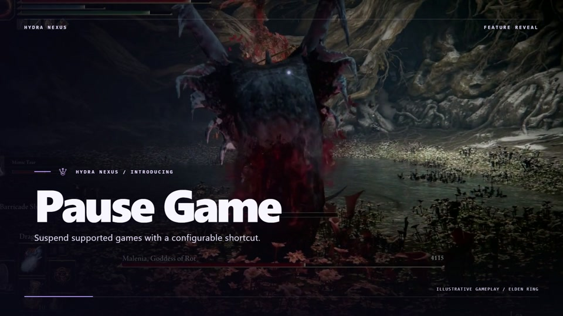
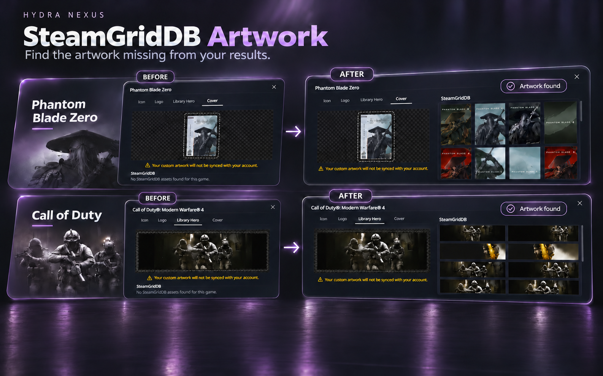

[English](../../README.md) · [Português (Brasil)](pt-BR.md) · [Español](es.md) · [Русский](ru.md) · [العربية](ar.md) · [Français](fr.md) · [Deutsch](de.md) · [Türkçe](tr.md) · [Polski](pl.md)

# Hydra Nexus

Hydra Nexus is a community extension for Hydra Launcher on Windows. Discover a redesigned interface with Nexus Discovery, new achievement notifications, a library release calendar, local and cloud backups, per-game Steam accounts, play activity, storage tools, tabs, notes and custom backgrounds. Choose the tools you need in Plugins. Nexus follows Hydra’s selected language and works with your theme. An existing Hydra Launcher installation is required.

**[Download installer](https://github.com/M0KA40/Hydra-Nexus/releases/latest/download/Hydra_Nexus.exe)** · [Release notes](https://github.com/M0KA40/Hydra-Nexus/releases/latest) · [Report a problem](https://github.com/M0KA40/Hydra-Nexus/issues/new/choose)

## Nexus Discovery


**Your Hydra experience, reimagined.**

Nexus Discovery refreshes Hydra from Home to the details of each game. A cinematic Home spotlight presents four of Steam’s most active games, alongside new releases and discoveries inspired by your library. Refined catalogue and library layouts, subtle glass effects on game covers and smooth transitions give browsing a new look.

Game pages organize content into Overview, Updates, About, Community and Details, including developer news and patch notes from Steam. Downloads put the game artwork and progress front and center. Redesigned Play Activity and per-game statistics bring your games, playtime, active days and sessions into focus, with weekly and monthly recaps that follow your selected theme.

**Where to use it:** Settings → Hydra Nexus → Themes; achievement notification options in Settings.

### Achievement notifications

A new Nexus Discovery notification design brings its own look and motion to normal, hidden, rare and platinum achievements. Switch between the Nexus design and Hydra’s original notifications in Settings, customize the notification sound, and preview it with **Try notification**.

[](https://raw.githubusercontent.com/M0KA40/Hydra-Nexus/main/assets/media/nexus-discovery-achievements.mp4)

## Steam launch settings


Assign a saved Steam account and launch mode to each game. Default / standalone launches normally without asking Nexus to start or switch Steam; an existing Steam session stays unchanged. Steam online uses a saved personal account online. Steam offline forces the selected account offline, including shared accounts. Only accounts already saved in Steam are listed. Turn off Steam’s account-choice prompt on startup to allow automatic switching.

**Where to use it:** Library → game page → Steam button beside Play

## Game Release Calendar


Follow release dates for games already in your library, all in one monthly calendar. See upcoming and past releases with game covers on their release days. Games sharing a date are grouped together; select a day to browse its games and open a game’s page directly.

Dates refresh when data is available, with saved dates kept when a refresh fails. Games with only a year or an unconfirmed date such as TBA stay in a separate list, without assigning a guessed release day.

**Where to use it:** Settings → Hydra Nexus → Plugins → Release Calendar; then Library → Calendar.

## Nexus Cloud · BETA


Keep supported saves and local achievements in local backups, in your own Dropbox or OneDrive account, or both. Review backup status, back up one game or all eligible games, and optionally create backups after a game closes.

Before restoring, review files and destinations, verify backup integrity and confirm replacements. Safety copies protect affected files. Cloud storage uses your own account, and optional password encryption protects new backup packages. Keep the original password safely. Restoring local achievement files does not unlock Steam or Epic account achievements.

**Where to use it:** Settings → Hydra Nexus → Plugins → Nexus Cloud; then Nexus Cloud in the sidebar.

## Game Pause

[](https://raw.githubusercontent.com/M0KA40/Hydra-Nexus/main/assets/media/hydra-nexus-game-pause.mp4)

**Take a break and pick up exactly where you left off.**

Pause supported single-player games, including cutscenes, even when the game has no pause option. Press **F5** to pause and press it again to resume, even from another window. You can also customize the shortcut to suit you.

**Windows 11 is required.** **For supported single-player games only. Do not use in online games or games with anti-cheat.**

**Where to use it:** Settings → Hydra Nexus → Plugins → Game Pause → Manage.

## SteamGridDB Artwork



**Find the artwork missing from your results.**

Use your own **SteamGridDB API key** to recover missing results inside Hydra’s existing **Customization** artwork picker, including **Icon, Logo, Library Hero and Cover**. When Hydra returns no artwork for a supported library game, Nexus looks for a reliable matching SteamGridDB record and shows the available images in the same picker. Choose the image you want; Nexus does not replace your artwork automatically.

Create a SteamGridDB account, get your API key from your account preferences, then validate and save it in Nexus and enable the plugin. The key is encrypted on your device and excluded from settings exports. Working artwork results stay unchanged. Availability depends on the game and SteamGridDB; a match is not guaranteed for every title.

**Where to use it:** Settings → Hydra Nexus → Plugins → SteamGridDB Artwork → Manage; then open a game’s Customization.

## Game Storage Manager


Browse installed games by drive, available space and measured file sizes. Search and sort by size or last played. Open a game folder or move selected games after reviewing the destination and required space. Copied files are verified before Hydra’s paths are updated and originals removed. Uncertain folders require confirmation; partial measurements are labelled. External launcher registrations and desktop shortcuts are not rewritten.

**Where to use it:** Settings → below Big Picture → Game Storage Manager

## Play Activity


Explore a redesigned history of your games, playtime, active days and sessions. Switch between weekly, monthly and custom periods, and open each game’s statistics for more detail. Recap notifications use artwork from the period and colors suited to your theme. Manage notices from the bell. Detailed session history begins when Nexus starts tracking; lifetime totals cannot reconstruct earlier sessions.

**Where to use it:** Sidebar → Play activity; graph beside a game’s playtime

## Extract Path


Download archives to one drive and extract the game to another. Enable automatic extraction in Download settings and choose Extract path. Nexus remembers the last accepted destination and keeps a destination for each queued download. A game folder is created inside it. Original archives remain in their download location for resume/seeding unless you separately enable archive deletion after extraction.

**Where to use it:** Download settings → automatic extraction → Extract path

## Download Finish Actions


Choose a notification, Sleep or PC Shutdown after the whole download queue and enabled extractions finish. Power actions have 60 seconds to cancel. New downloads resume waiting; closing Hydra cancels the pending action. Enabling the plugin requires a Hydra restart, and restart never automatically arms a power action.

**Where to use it:** Downloads → beside Cancel → Download Finish Actions

## Invisible Mode


Control Hydra activity sharing while retaining local progress and access to artwork. Enabling the plugin activates Invisible Mode immediately; change it afterward from the account menu. Private activity stays local after turning the mode off until you explicitly resume sharing. Presence updates can take time, and game notifications also depend on Hydra servers.

**Where to use it:** Account menu → below Friends → Invisible Mode

## Game Tabs


Open multiple game pages in tabs within the same Hydra window and return to your place. Catalogue search results, filters and scroll are retained. Right-click a game in Catalogue or Library and choose Open in New Tab; switch using the tab bar and close with ×. Tabs belong to the current Hydra session and are not restored after a full application restart.

**Where to use it:** Catalogue or Library → right-click → Open in New Tab

## Custom backgrounds

https://github.com/user-attachments/assets/f69ff1b4-6250-43b1-a5d7-98ca3722d952

Choose your own local image or video as Hydra’s background. Adjust darkness and blur, optionally pause video while Hydra is inactive, and restore the theme background with Reset. Supported video playback depends on the codec; H.264 MP4 or WebM is recommended.

**Where to use it:** Hydra Nexus Settings → Themes → Choose image or video

## Additional tools

- Game Page Layout — Choose which game-page sections appear and arrange their order from Plugins.

- Game Notes — text and links per game, an independent window, Always on top and a focus shortcut.
- Nexus Mods — open the matched game’s mods page or search when no reliable match is available.
- PC Compatibility — compare confirmed PC specifications with published minimum requirements. Estimates are not FPS predictions.
- Updater — check releases, verify the downloaded installer and update/restart from Hydra.

## Supported interface languages

| Language | Native name | Nexus interface |
| --- | --- | --- |
| en | English | ✓ Supported |
| pt-BR | Português (Brasil) | ✓ Supported |
| es | Español | ✓ Supported |
| ru | Русский | ✓ Supported |
| ar | العربية | ✓ Supported |
| fr | Français | ✓ Supported |
| de | Deutsch | ✓ Supported |
| tr | Türkçe | ✓ Supported |
| pl | Polski | ✓ Supported |

## Install and update

1. Download Hydra_Nexus.exe from Releases.
2. Exit Hydra completely, including its tray icon.
3. Run the EXE and choose Install / Update / Repair.
4. Open Hydra → Settings → Hydra Nexus → Plugins.

No separate Node.js or Python installation is needed to run the installer. Updating keeps Nexus settings, Notes, play history. If a Hydra update replaces the modification, reapply a compatible Nexus build. Nexus is independent of Hydra Launcher, Valve, Google and Nexus Mods. Include both app versions and reproduction steps when reporting problems.

## More information

[Support](../../SUPPORT.md) · [Changelog](../../CHANGELOG.md) · [Contributing](../../CONTRIBUTING.md) · [MIT](../../LICENSE) · [Third-party notices](../../THIRD_PARTY_NOTICES.md)

## Build from source

```sh
python build.py
```

## Native EXE architecture

[Installer, update flow and build documentation](../../docs/native-exe.md).


