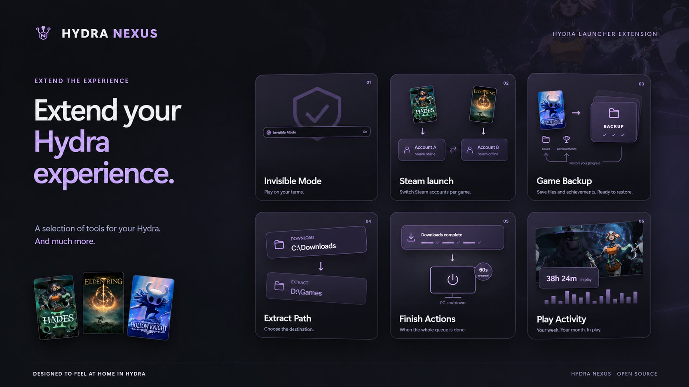

[English](../../README.md) · [Português (Brasil)](pt-BR.md) · [Español](es.md) · [Русский](ru.md) · [العربية](ar.md) · [Français](fr.md) · [Deutsch](de.md) · [Türkçe](tr.md) · [Polski](pl.md)

# Hydra Nexus

Hydra Nexus es una extensión comunitaria de Hydra Launcher para Windows. Descubre Nexus Discovery, las nuevas notificaciones de logros, el calendario de lanzamientos de tu biblioteca, copias locales y en la nube, cuentas de Steam por juego, actividad de juego, herramientas de almacenamiento, pestañas, notas y fondos personalizados. Activa las herramientas que necesites en Plugins. Nexus sigue el idioma de Hydra y funciona con tu tema. Requiere una instalación de Hydra Launcher.

**[Descargar instalador](https://github.com/M0KA40/Hydra-Nexus/releases/latest/download/Hydra_Nexus.exe)** · [Notas de versión](https://github.com/M0KA40/Hydra-Nexus/releases/latest) · [Informar de un problema](https://github.com/M0KA40/Hydra-Nexus/issues/new/choose)

## Nexus Discovery

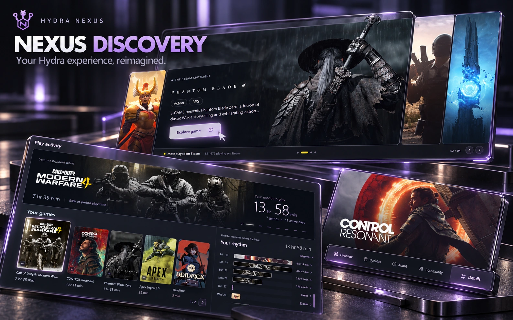

**Tu experiencia con Hydra, reinventada.**

Nexus Discovery renueva Hydra desde el inicio hasta los detalles de cada juego. El inicio presenta un escaparate cinematográfico con cuatro de los juegos más activos de Steam, además de novedades y recomendaciones inspiradas en tu biblioteca. El catálogo y la biblioteca incorporan una presentación más cuidada, efectos de cristal sutiles en las carátulas y transiciones suaves.

Las páginas de juegos organizan el contenido en Vista general, Actualizaciones, Acerca de, Comunidad y Detalles, con noticias y notas de actualización de los desarrolladores en Steam. Descargas da protagonismo al arte del juego y al progreso. La actividad y las estadísticas de cada juego presentan tus juegos, tiempo de juego, días activos y sesiones, con resúmenes semanales y mensuales adaptados al tema elegido.

**Dónde usarlo:** Ajustes → Hydra Nexus → Temas; opciones de notificaciones de logros en Ajustes.

### Notificaciones de logros

El nuevo diseño Nexus Discovery aporta un estilo y animaciones propios a los logros normales, ocultos, raros y de platino. En Ajustes puedes alternar entre Nexus y las notificaciones originales de Hydra, personalizar el sonido y ver una vista previa con **Probar notificación**. La prueba no desbloquea logros ni modifica su historial.

https://github.com/user-attachments/assets/5adbe1b9-05c3-460a-ad13-85ad4a72fe4c

## Opciones de inicio de Steam

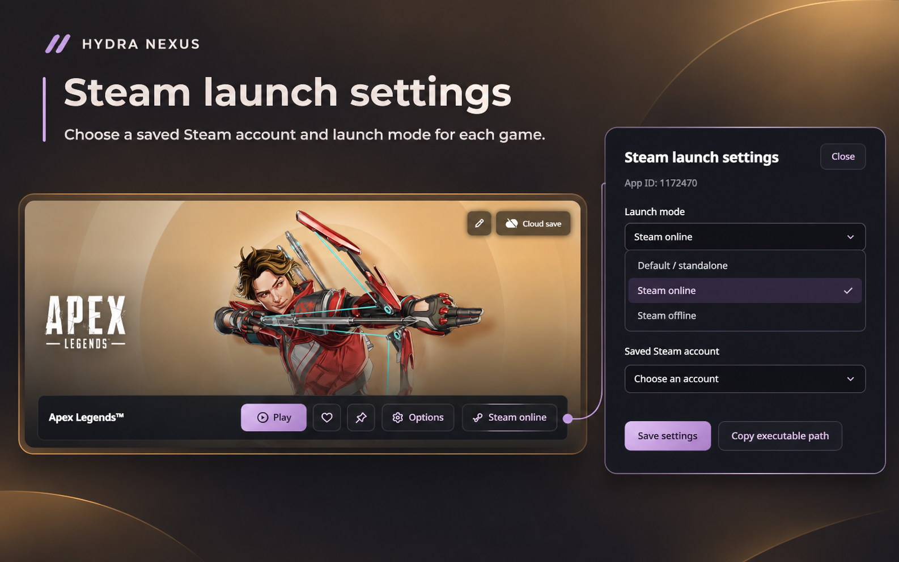

Asigna a cada juego una cuenta de Steam guardada y un modo de inicio. Default / standalone no pide a Nexus que inicie Steam ni cambie de cuenta; una sesión abierta permanece intacta. Steam online usa una cuenta personal conectada. Steam offline fuerza el modo sin conexión de la cuenta elegida, incluidas las compartidas. Solo aparecen cuentas ya guardadas. Desactiva la pregunta de selección de cuenta al iniciar Steam para permitir el cambio automático.

**Dónde usarlo:** Biblioteca → página del juego → botón Steam junto a Jugar

## Calendario de lanzamientos

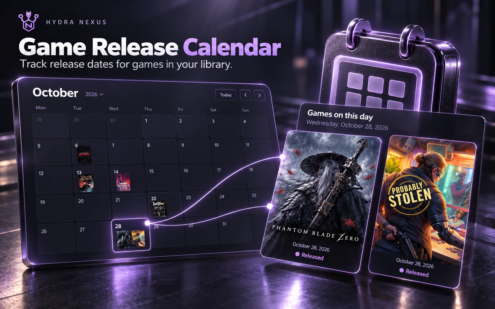

Sigue las fechas de lanzamiento de los juegos de tu biblioteca en un calendario mensual. Consulta lanzamientos futuros y pasados con sus carátulas en cada fecha. Los juegos que comparten fecha se agrupan; selecciona un día para verlos y abrir sus páginas.

Las fechas se actualizan cuando hay datos disponibles; si la actualización falla, se conservan las guardadas. Los juegos que solo tienen un año o una fecha sin confirmar permanecen en una lista aparte, sin inventar un día de lanzamiento.

**Dónde usarlo:** Ajustes → Hydra Nexus → Plugins → Calendario de lanzamientos; después Biblioteca → Calendario.

## Nexus Cloud · BETA

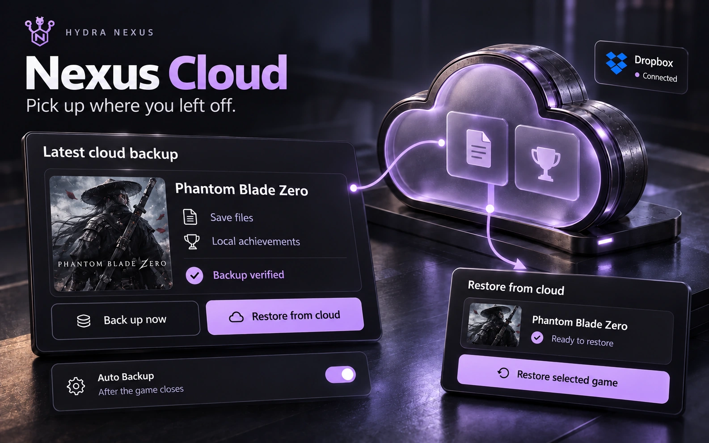

Guarda partidas y logros locales compatibles en copias locales, en tu cuenta de Dropbox o OneDrive, o en ambos. Revisa su estado, copia un juego o todos los compatibles y, si quieres, crea copias al cerrar los juegos.

Antes de restaurar, revisa archivos y destinos, verifica la integridad y confirma las sustituciones. Las copias de seguridad protegen los archivos afectados. La nube utiliza el almacenamiento de tu cuenta; el cifrado opcional protege los paquetes nuevos. Guarda la contraseña original en un lugar seguro. Restaurar archivos de logros locales no desbloquea logros en Steam o Epic.

**Dónde usarlo:** Ajustes → Hydra Nexus → Plugins → Nexus Cloud; después Nexus Cloud en la barra lateral.

## Gestor de almacenamiento de juegos

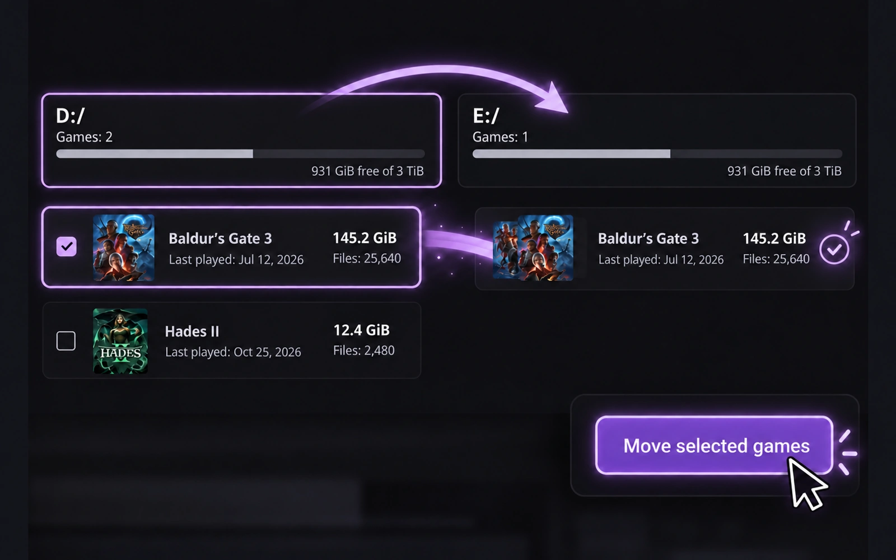

Consulta juegos instalados por unidad, espacio libre y tamaño medido. Busca y ordena por tamaño o último uso. Abre una carpeta o mueve juegos tras revisar destino y espacio. Las copias se verifican antes de actualizar rutas y eliminar originales. Se indican carpetas inciertas y mediciones parciales. No se modifican registros de otros lanzadores ni accesos directos.

**Dónde usarlo:** Ajustes → debajo de Big Picture → Gestor de almacenamiento de juegos

## Actividad de juego

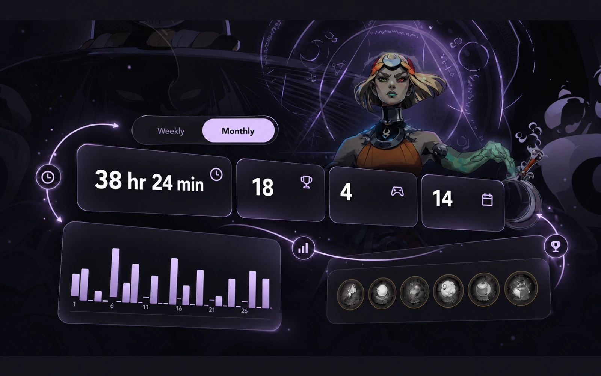

Explora el historial rediseñado de juegos, tiempo de juego, días activos y sesiones. Cambia entre periodos semanales, mensuales y personalizados y abre las estadísticas de cada juego. Los resúmenes utilizan imágenes del periodo y colores de tu tema. Gestiona los avisos desde la campana. El historial detallado empieza cuando Nexus registra las sesiones; los totales antiguos no permiten reconstruir sesiones anteriores.

**Dónde usarlo:** Barra lateral → Actividad de juego; gráfico junto al tiempo de juego

## Carpeta de extracción

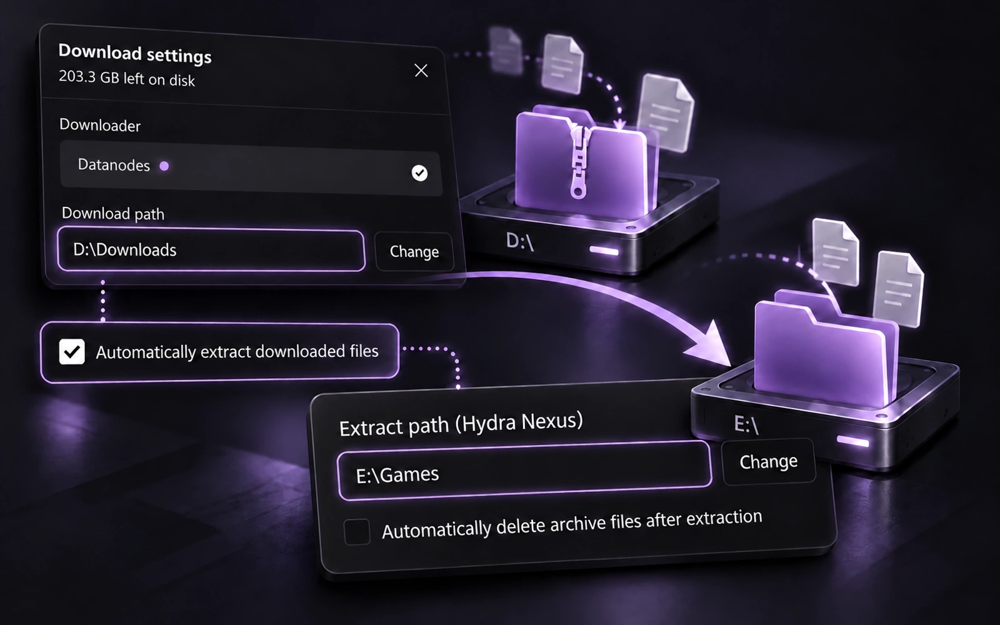

Descarga archivos en una unidad y extrae el juego en otra. Activa la extracción automática y elige Extract path. Nexus recuerda el último destino aceptado y el de cada descarga en cola, creando una carpeta por juego. Los archivos permanecen en el destino de descarga para reanudar/compartir, salvo que actives por separado su eliminación tras extraer.

**Dónde usarlo:** Ajustes de descarga → extracción automática → Carpeta de extracción

## Acciones al finalizar descargas

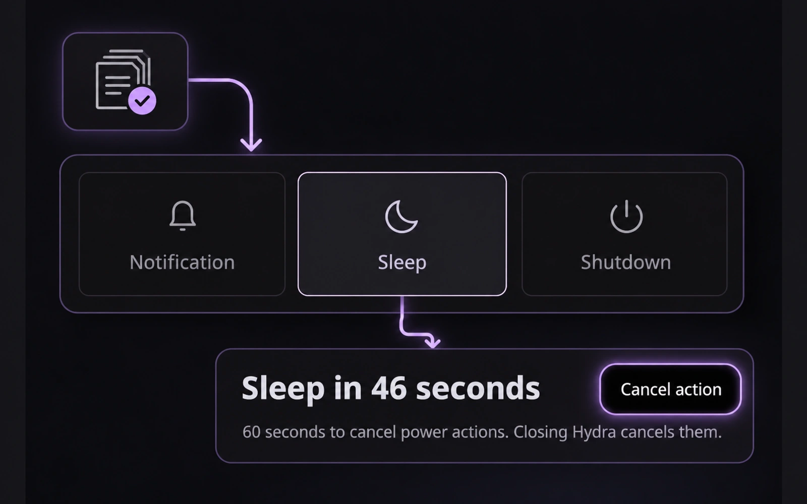

Elige aviso, suspensión o apagado del PC cuando termine toda la cola y las extracciones activadas. Hay 60 segundos para cancelar acciones de energía. Nuevas descargas reanudan la espera; cerrar Hydra cancela. Activar el plugin exige reiniciar Hydra y nunca arma automáticamente una acción.

**Dónde usarlo:** Descargas → junto a Cancelar → Acciones al finalizar descargas

## Modo invisible

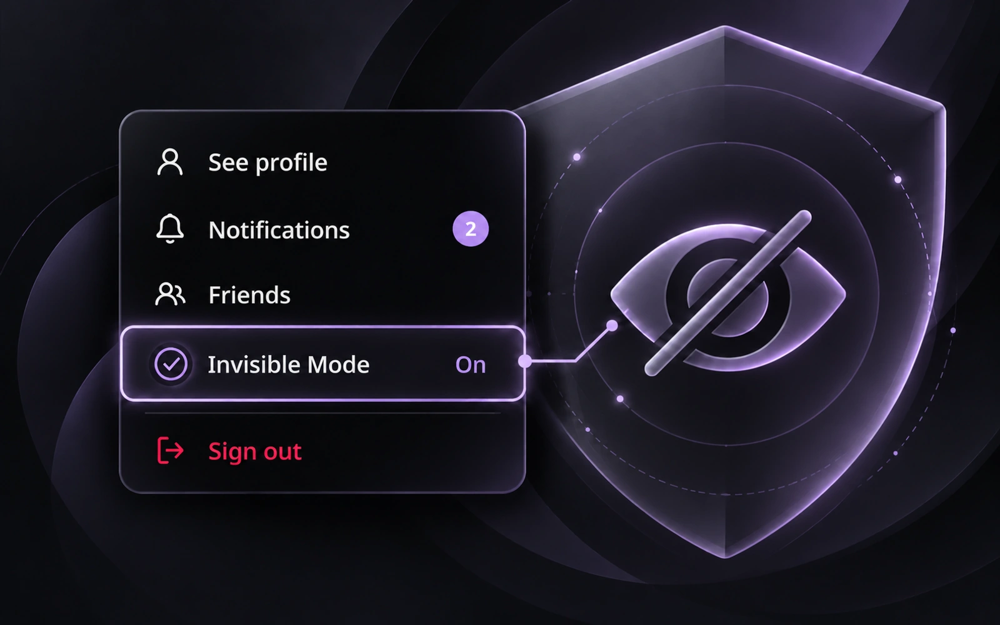

Controla el uso compartido de actividad en Hydra conservando progreso local e imágenes. Activar el plugin enciende Invisible Mode; luego puedes cambiarlo en el menú de cuenta. La actividad privada sigue local al desactivarlo hasta reanudar explícitamente su envío. La presencia puede tardar y los avisos también dependen de los servidores de Hydra.

**Dónde usarlo:** Menú de cuenta → debajo de Amigos → Modo invisible

## Pestañas de juegos

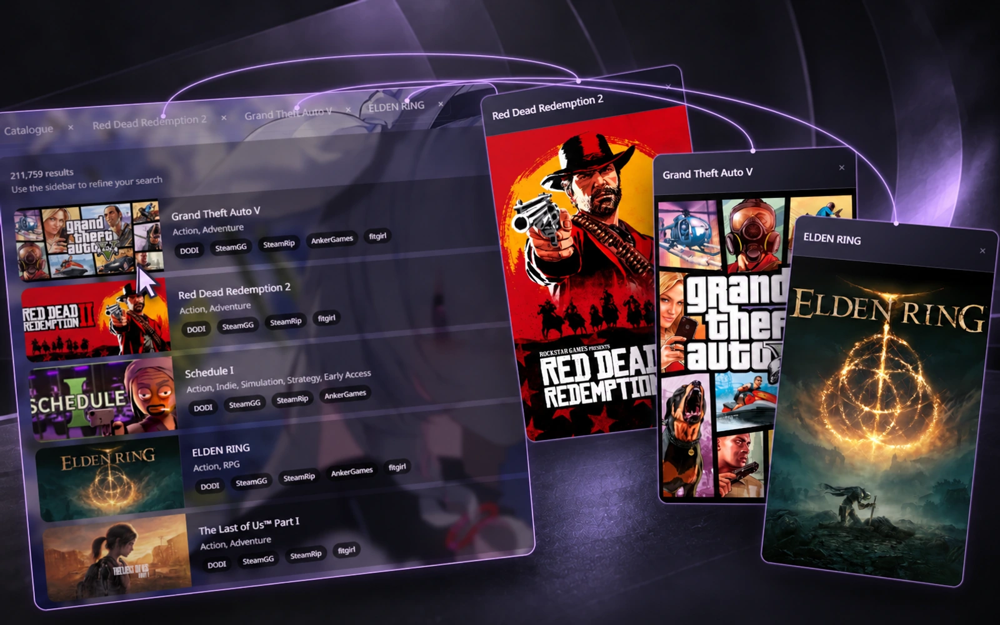

Abre varias páginas de juegos en pestañas de la misma ventana. Se conservan resultados, filtros y desplazamiento del catálogo. Haz clic derecho en Catálogo o Biblioteca y elige Open in New Tab; cambia en la barra y cierra con ×. Las pestañas pertenecen a la sesión actual y no se recuperan tras reiniciar completamente.

**Dónde usarlo:** Catálogo o Biblioteca → clic derecho → Abrir en nueva pestaña

## Fondos personalizados

https://github.com/user-attachments/assets/f69ff1b4-6250-43b1-a5d7-98ca3722d952

Elige una imagen o vídeo local como fondo. Ajusta oscuridad y desenfoque, pausa opcionalmente el vídeo cuando Hydra esté inactivo y restaura el fondo del tema con Reset. La reproducción depende del códec; se recomienda H.264 MP4 o WebM.

**Dónde usarlo:** Ajustes de Hydra Nexus → Temas → Elegir imagen o vídeo

## Otras herramientas

- Game Page Layout — Elige las secciones de las páginas de juegos y ordena su posición desde Plugins.

- Game Notes — texto y enlaces por juego, ventana independiente, siempre visible y atajo para enfocarla.
- Nexus Mods — abre la página de mods correspondiente o una búsqueda si no hay coincidencia fiable.
- PC Compatibility — compara especificaciones confirmadas con requisitos mínimos publicados; no predice FPS.
- Updater — busca versiones, verifica el instalador y actualiza/reinicia Hydra.

## Idiomas de la interfaz

| Idioma | Nombre nativo | Interfaz de Nexus |
| --- | --- | --- |
| en | English | ✓ Compatible |
| pt-BR | Português (Brasil) | ✓ Compatible |
| es | Español | ✓ Compatible |
| ru | Русский | ✓ Compatible |
| ar | العربية | ✓ Compatible |
| fr | Français | ✓ Compatible |
| de | Deutsch | ✓ Compatible |
| tr | Türkçe | ✓ Compatible |
| pl | Polski | ✓ Compatible |

## Instalación y actualización

1. Descarga Hydra_Nexus.exe desde Releases.
2. Cierra Hydra por completo, incluido el icono de la bandeja.
3. Ejecuta el EXE y elige Install / Update / Repair.
4. Abre Hydra → Settings → Hydra Nexus → Plugins.

El instalador no necesita Node.js o Python por separado. Se mantienen ajustes, notas, historial . Si una actualización de Hydra reemplaza los cambios, reaplica una versión compatible. Proyecto independiente de Hydra Launcher, Valve, Google y Nexus Mods. Incluye versiones y pasos de reproducción al informar de errores.

## Más información

[Ayuda](../../SUPPORT.md) · [Changelog](../../CHANGELOG.md) · [Contributing](../../CONTRIBUTING.md) · [MIT](../../LICENSE) · [Third-party notices](../../THIRD_PARTY_NOTICES.md)

## Compilar desde el código

```sh
python build.py
```


