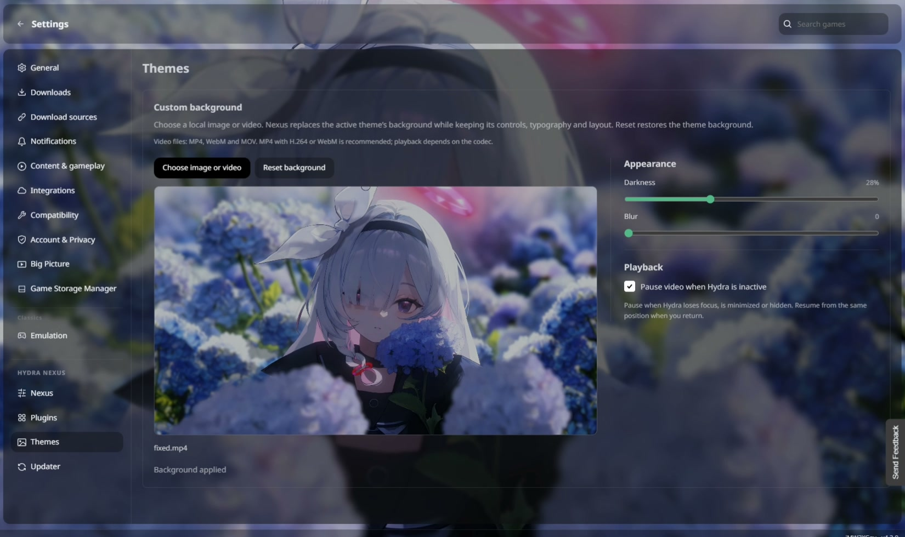

[English](../../README.md) · [Português (Brasil)](pt-BR.md) · [Español](es.md) · [Русский](ru.md) · [العربية](ar.md) · [Français](fr.md) · [Deutsch](de.md) · [Türkçe](tr.md) · [Polski](pl.md)

# Hydra Nexus

Hydra Nexus to społecznościowe rozszerzenie Hydra Launcher dla Windows. Dodaje zarządzanie miejscem, kopie zapisów i lokalnych osiągnięć, konta Steam dla poszczególnych gier, aktywność, karty, notatki i własne tła. Włącz potrzebne narzędzia w Plugins. Interfejs korzysta z języka Hydra i natywnych elementów zgodnych z motywem. Wymaga zainstalowanego Hydra Launcher.

**[Pobierz instalator](https://github.com/M0KA40/Hydra-Nexus/releases/latest/download/Hydra_Nexus.bat)** · [Informacje o wydaniu](../../docs/releases/2.0.0/pl.md) · [Zgłoś problem](https://github.com/M0KA40/Hydra-Nexus/issues/new/choose)

## Steam launch settings


Przypisz grze zapisane konto Steam i tryb uruchamiania. Default / standalone nie prosi Nexus o uruchomienie Steam ani zmianę konta; otwarta sesja pozostaje bez zmian. Steam online używa osobistego konta online. Steam offline wymusza tryb offline wybranego konta, także współdzielonego. Lista zawiera tylko konta zapisane w Steam. Wyłącz pytanie o wybór konta przy starcie Steam, aby umożliwić automatyczne przełączanie.

**Gdzie używać:** Library → game page → Steam button beside Play

## Game Storage Manager


Przeglądaj zainstalowane gry według dysku, wolnego miejsca i zmierzonego rozmiaru. Wyszukuj i sortuj według rozmiaru lub ostatniej gry. Otwieraj foldery lub przenoś gry po sprawdzeniu celu i miejsca. Kopie są weryfikowane przed zmianą ścieżek i usunięciem oryginałów. Niepewne foldery i niepełne pomiary są oznaczone. Wpisy innych launcherów i skróty nie są zmieniane.

**Gdzie używać:** Settings → below Big Picture → Game Storage Manager

## Play Activity


Przeglądaj sesje, czas gry i datę ostatniej gry. Podsumowania tygodnia i miesiąca pokazują gry, aktywne dni i dostępne osiągnięcia z datami. Zarządzaj powiadomieniami dzwonkiem lub wyłącz podsumowania i powiadomienia, zachowując rejestrowanie sesji. Historia zaczyna się wraz ze śledzeniem Nexus; wcześniejsze sumy nie odtwarzają starych sesji.

**Gdzie używać:** Sidebar → Play activity; per-game graph beside playtime

## Game Backup


Zachowuj osobne punkty przywracania zapisów i lokalnych osiągnięć każdej gry. Przywróć, otwórz folder lub wypakuj zweryfikowaną kopię bez zastępowania bieżących zapisów. Dodaj folder albo zatrzymaj nowe kopie gry, zachowując historię. Dla chmury wybierz folder synchronizowany przez Dysk Google na komputer: synchronizuje go Drive bez logowania Google w Nexus. Zamknij gry przed przywróceniem. Lokalne osiągnięcia nie odblokowują osiągnięć kont Steam/Epic.

**Gdzie używać:** Sidebar → Backup; game Options → General → Backup

## Extract Path


Pobieraj archiwa na jeden dysk i wypakowuj grę na inny. Włącz automatyczne wypakowywanie i wybierz Extract path. Nexus pamięta ostatni zaakceptowany cel oraz cel każdego pobierania w kolejce, tworząc folder gry. Archiwa pozostają do wznawiania/seedowania, chyba że osobno włączysz usuwanie po wypakowaniu.

**Gdzie używać:** Download settings → automatic extraction → Extract path

## Download Finish Actions


Wybierz powiadomienie, uśpienie lub wyłączenie komputera po całej kolejce i włączonych wypakowaniach. Masz 60 sekund na anulowanie operacji zasilania. Nowe pobierania wznawiają oczekiwanie; zamknięcie Hydra anuluje operację. Włączenie wtyczki wymaga restartu, który nie uzbraja automatycznie operacji zasilania.

**Gdzie używać:** Downloads → beside Cancel → Download Finish Actions

## Invisible Mode


Kontroluj udostępnianie aktywności Hydra, zachowując lokalny postęp i obrazy. Włączenie wtyczki od razu aktywuje Invisible Mode; później zmienisz go w menu konta. Prywatna aktywność pozostaje lokalna po wyłączeniu, aż jawnie wznowisz udostępnianie. Aktualizacja obecności może potrwać; powiadomienia zależą też od serwerów Hydra.

**Gdzie używać:** Account menu → below Friends → Invisible Mode

## Game Tabs


Otwieraj wiele stron gier w kartach jednego okna. Wyniki katalogu, filtry i przewijanie są zachowywane. Kliknij grę prawym przyciskiem w katalogu lub bibliotece → Open in New Tab; przełączaj paskiem i zamykaj przez ×. Karty dotyczą bieżącej sesji i nie wracają po pełnym restarcie aplikacji.

**Gdzie używać:** Catalogue or Library → right-click → Open in New Tab

## Custom backgrounds

[](../../assets/media/custom-background.mp4)

Wybierz lokalny obraz lub film jako tło. Ustaw przyciemnienie i rozmycie, opcjonalnie wstrzymuj film przy nieaktywnym Hydra i przywróć tło motywu przez Reset. Odtwarzanie zależy od kodeka; zalecane H.264 MP4 lub WebM.

**Gdzie używać:** Hydra Nexus Settings → Themes → Choose image or video

## Dodatkowe narzędzia

- Game Notes — tekst i linki dla gry, osobne okno, zawsze na wierzchu i skrót ustawiania fokusu.
- Nexus Mods — otwiera właściwą stronę modów lub wyszukiwanie, gdy brak pewnego dopasowania.
- PC Compatibility — porównuje potwierdzone podzespoły z opublikowanymi wymaganiami minimalnymi; nie przewiduje FPS.
- Updater — sprawdza wydania i instalator, aktualizuje oraz uruchamia Hydra ponownie.

## Języki interfejsu

| Język | Nazwa własna | Interfejs Nexus |
| --- | --- | --- |
| en | English | ✓ Obsługiwany |
| pt-BR | Português (Brasil) | ✓ Obsługiwany |
| es | Español | ✓ Obsługiwany |
| ru | Русский | ✓ Obsługiwany |
| ar | العربية | ✓ Obsługiwany |
| fr | Français | ✓ Obsługiwany |
| de | Deutsch | ✓ Obsługiwany |
| tr | Türkçe | ✓ Obsługiwany |
| pl | Polski | ✓ Obsługiwany |

## Instalacja i aktualizacja

1. Pobierz Hydra_Nexus.bat z Releases.
2. Zamknij Hydra całkowicie, także ikonę zasobnika.
3. Uruchom BAT i wybierz Install / Update / Repair.
4. Otwórz Hydra → Settings → Hydra Nexus → Plugins.

Instalator nie wymaga osobnej instalacji Node.js ani Python. Ustawienia, notatki, historia i kopie zostają zachowane. Jeśli aktualizacja Hydra nadpisze modyfikacje, zastosuj zgodny Nexus ponownie. Projekt niezależny od Hydra Launcher, Valve, Google i Nexus Mods. W zgłoszeniach podaj wersje i kroki odtworzenia.

## Informacje

[Privacy](../../docs/privacy.md) · [Troubleshooting](../../docs/troubleshooting.md) · [Changelog](../../CHANGELOG.md) · [Contributing](../../CONTRIBUTING.md) · [MIT](../../LICENSE) · [Third-party notices](../../THIRD_PARTY_NOTICES.md)

## Budowanie ze źródeł

```sh
python build.py
```
