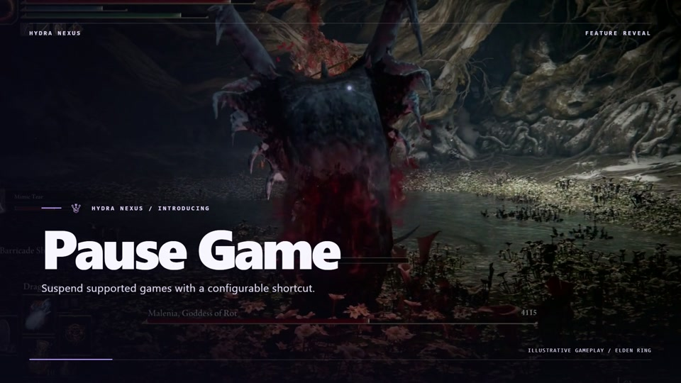
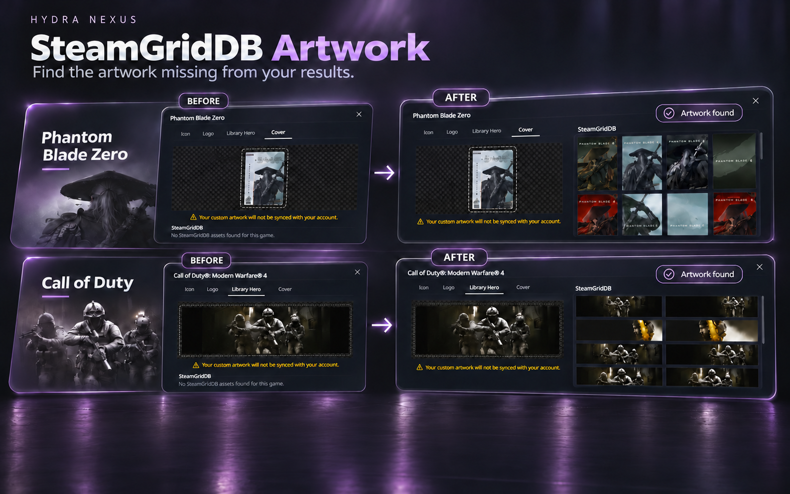

[English](../../README.md) · [Português (Brasil)](pt-BR.md) · [Español](es.md) · [Русский](ru.md) · [العربية](ar.md) · [Français](fr.md) · [Deutsch](de.md) · [Türkçe](tr.md) · [Polski](pl.md)

# Hydra Nexus

Hydra Nexus é uma extensão comunitária do Hydra Launcher para Windows. Conheça a interface Nexus Discovery, novas notificações de conquistas, calendário de lançamentos da biblioteca, backups locais e na nuvem, contas Steam por jogo, atividade de jogo, ferramentas de armazenamento, abas, notas e fundos personalizados. Ative as ferramentas desejadas em Plugins. O Nexus acompanha o idioma do Hydra e funciona com o seu tema. É necessário ter o Hydra Launcher instalado.

**[Baixar instalador](https://github.com/M0KA40/Hydra-Nexus/releases/latest/download/Hydra_Nexus.exe)** · [Notas da versão](https://github.com/M0KA40/Hydra-Nexus/releases/latest) · [Relatar problema](https://github.com/M0KA40/Hydra-Nexus/issues/new/choose)

## Nexus Discovery


**Sua experiência com o Hydra, reinventada.**

Nexus Discovery renova o Hydra, da página inicial aos detalhes de cada jogo. A página inicial ganha um destaque cinematográfico com quatro dos jogos mais ativos no Steam, além de lançamentos e descobertas inspiradas na sua biblioteca. O catálogo e a biblioteca recebem layouts refinados, efeitos sutis de vidro nas capas e transições suaves.

As páginas dos jogos organizam o conteúdo em Visão geral, Atualizações, Sobre, Comunidade e Detalhes, incluindo notícias e notas de atualização dos desenvolvedores no Steam. A página de downloads destaca a arte do jogo e o progresso. A atividade de jogo e as estatísticas individuais foram redesenhadas para mostrar jogos, tempo de jogo, dias ativos e sessões, com resumos semanais e mensais que acompanham o tema escolhido.

**Onde usar:** Configurações → Hydra Nexus → Temas; opções das notificações de conquistas nas Configurações.

### Notificações de conquistas

O novo design Nexus Discovery traz visual e animações próprios para conquistas normais, ocultas, raras e de platina. Nas Configurações, alterne entre o design Nexus e as notificações originais do Hydra, personalize o som e veja uma prévia com **Testar notificação**.

[](https://raw.githubusercontent.com/M0KA40/Hydra-Nexus/main/assets/media/nexus-discovery-achievements.mp4)

## Configurações de inicialização do Steam


Associe a cada jogo uma conta Steam salva e um modo de inicialização. Default / standalone não solicita ao Nexus iniciar o Steam nem trocar de conta; uma sessão aberta permanece igual. Steam online usa uma conta pessoal conectada. Steam offline força o modo offline da conta escolhida, inclusive compartilhada. Só aparecem contas já salvas. Desative a pergunta de escolha de conta ao iniciar o Steam para permitir a troca automática.

**Onde usar:** Biblioteca → página do jogo → botão Steam ao lado de Jogar

## Calendário de lançamentos


Acompanhe as datas de lançamento dos jogos da sua biblioteca em um calendário mensal. Veja lançamentos futuros e passados com as capas nos respectivos dias. Jogos com a mesma data ficam agrupados; selecione um dia para ver os jogos e abrir suas páginas.

As datas são atualizadas quando há dados disponíveis; se a atualização falhar, as datas salvas continuam visíveis. Jogos com apenas o ano ou uma data ainda não confirmada ficam em uma lista separada, sem atribuir um dia de lançamento estimado.

**Onde usar:** Configurações → Hydra Nexus → Plugins → Calendário de lançamentos; depois Biblioteca → Calendário.

## Nexus Cloud · BETA


Guarde saves e conquistas locais compatíveis em backups locais, na sua conta Dropbox ou OneDrive, ou nos dois. Confira o estado das cópias, faça backup de um jogo ou de todos os elegíveis e, se quiser, crie cópias após fechar os jogos.

Antes de restaurar, revise arquivos e destinos, verifique a integridade e confirme as substituições. Cópias de segurança protegem os arquivos afetados. A nuvem usa o armazenamento da sua conta; a criptografia opcional protege novos pacotes. Guarde a senha original com segurança. Restaurar arquivos locais de conquistas não desbloqueia conquistas nas contas Steam ou Epic.

**Onde usar:** Configurações → Hydra Nexus → Plugins → Nexus Cloud; depois Nexus Cloud na barra lateral.

## Game Pause

[](https://raw.githubusercontent.com/M0KA40/Hydra-Nexus/main/assets/media/hydra-nexus-game-pause.mp4)

**Faça uma pausa e continue exatamente de onde parou.**

Pause jogos de um jogador compatíveis, incluindo cenas cinematográficas, mesmo quando o jogo não oferece essa opção. Pressione **F5** para pausar e novamente para continuar, inclusive a partir de outra janela. Você também pode personalizar o atalho como preferir.

**Requer o Windows 11.** **Somente para jogos de um jogador compatíveis. Não use em jogos online nem em jogos com sistemas antitrapaça.**

**Onde usar:** Configurações → Hydra Nexus → Plugins → Game Pause → Gerenciar.

## SteamGridDB Artwork



**Encontre as imagens que faltam nos seus resultados.**

Use sua própria **chave de API do SteamGridDB** para recuperar resultados ausentes no seletor de imagens já existente em **Personalização** no Hydra, incluindo **Icon, Logo, Library Hero e Cover**. Quando o Hydra não encontra imagens para um jogo compatível da biblioteca, o Nexus procura uma correspondência confiável no SteamGridDB e mostra as imagens disponíveis no mesmo seletor. Você escolhe a imagem; o Nexus não substitui suas imagens automaticamente.

Crie uma conta no SteamGridDB, obtenha sua chave de API nas preferências da conta, valide e salve a chave no Nexus e ative o plugin. A chave é criptografada no dispositivo e não é incluída nas exportações de configurações. Os resultados que já funcionam permanecem inalterados. A disponibilidade depende do jogo e do SteamGridDB; não há garantia de correspondência para todos os títulos.

**Onde usar:** Configurações → Hydra Nexus → Plugins → SteamGridDB Artwork → Gerenciar; depois abra a Personalização de um jogo.

## Gerenciador de armazenamento de jogos


Veja jogos instalados por unidade, espaço livre e tamanho medido. Pesquise e ordene por tamanho ou último uso. Abra pastas ou mova jogos após revisar destino e espaço. As cópias são verificadas antes de atualizar caminhos e remover os originais. Pastas incertas e medições parciais são sinalizadas. Registros de outros launchers e atalhos não são alterados.

**Onde usar:** Configurações → abaixo de Big Picture → Gerenciador de armazenamento de jogos

## Atividade de jogo


Explore o histórico redesenhado de jogos, tempo de jogo, dias ativos e sessões. Alterne entre períodos semanais, mensais e personalizados e abra as estatísticas de cada jogo. Os resumos usam imagens do período e cores do seu tema. Gerencie os avisos pelo sino. O histórico detalhado começa com o rastreamento do Nexus; totais antigos não recriam sessões anteriores.

**Onde usar:** Barra lateral → Atividade de jogo; gráfico ao lado do tempo de jogo

## Pasta de extração


Baixe arquivos em uma unidade e extraia o jogo em outra. Ative a extração automática e escolha Extract path. O Nexus lembra o último destino aceito e o destino de cada download na fila, criando uma pasta por jogo. Os arquivos permanecem no local de download para retomada/seeding, salvo se você ativar sua exclusão após extração separadamente.

**Onde usar:** Configurações de download → extração automática → Pasta de extração

## Ações ao concluir downloads


Escolha notificação, suspensão ou desligamento do PC ao terminar toda a fila e as extrações ativadas. Há 60 segundos para cancelar ações de energia. Novos downloads retomam a espera; fechar o Hydra cancela. Ativar o plugin exige reiniciar o Hydra, sem armar automaticamente uma ação.

**Onde usar:** Downloads → ao lado de Cancelar → Ações ao concluir downloads

## Modo invisível


Controle o compartilhamento de atividade no Hydra mantendo progresso local e imagens. Ativar o plugin liga Invisible Mode imediatamente; depois altere pelo menu da conta. A atividade privada continua local após desligar até você retomar explicitamente o compartilhamento. A presença pode demorar a atualizar, e avisos dependem também dos servidores Hydra.

**Onde usar:** Menu da conta → abaixo de Amigos → Modo invisível

## Abas de jogos


Abra várias páginas de jogos em abas da mesma janela. Resultados, filtros e rolagem do catálogo são preservados. Clique com o botão direito no Catálogo ou Biblioteca e escolha Open in New Tab; alterne pela barra e feche com ×. As abas pertencem à sessão atual e não voltam após reiniciar totalmente o aplicativo.

**Onde usar:** Catálogo ou Biblioteca → clique direito → Abrir em nova aba

## Fundos personalizados

https://github.com/user-attachments/assets/f69ff1b4-6250-43b1-a5d7-98ca3722d952

Escolha uma imagem ou vídeo local como fundo. Ajuste escurecimento e desfoque, pause opcionalmente o vídeo com Hydra inativo e restaure o fundo do tema com Reset. A reprodução depende do codec; recomenda-se H.264 MP4 ou WebM.

**Onde usar:** Configurações do Hydra Nexus → Temas → Escolher imagem ou vídeo

## Outras ferramentas

- Game Page Layout — Escolha as seções das páginas de jogos e organize sua ordem em Plugins.

- Game Notes — texto e links por jogo, janela independente, sempre no topo e atalho de foco.
- Nexus Mods — abre a página correspondente ou uma busca quando não há correspondência confiável.
- PC Compatibility — compara especificações confirmadas com requisitos mínimos publicados; não prevê FPS.
- Updater — verifica versões e o instalador baixado, atualiza e reinicia o Hydra.

## Idiomas da interface

| Idioma | Nome nativo | Interface Nexus |
| --- | --- | --- |
| en | English | ✓ Compatível |
| pt-BR | Português (Brasil) | ✓ Compatível |
| es | Español | ✓ Compatível |
| ru | Русский | ✓ Compatível |
| ar | العربية | ✓ Compatível |
| fr | Français | ✓ Compatível |
| de | Deutsch | ✓ Compatível |
| tr | Türkçe | ✓ Compatível |
| pl | Polski | ✓ Compatível |

## Instalação e atualização

1. Baixe Hydra_Nexus.exe em Releases.
2. Feche completamente o Hydra, incluindo o ícone da bandeja.
3. Execute o EXE e escolha Install / Update / Repair.
4. Abra Hydra → Settings → Hydra Nexus → Plugins.

O instalador não exige Node.js ou Python separados. Configurações, notas, histórico são mantidos. Se uma atualização Hydra substituir as alterações, reaplique um Nexus compatível. Projeto independente de Hydra Launcher, Valve, Google e Nexus Mods. Informe versões e passos para reproduzir problemas.

## Mais informações

[Suporte](../../SUPPORT.md) · [Changelog](../../CHANGELOG.md) · [Contributing](../../CONTRIBUTING.md) · [MIT](../../LICENSE) · [Third-party notices](../../THIRD_PARTY_NOTICES.md)

## Compilar o código

```sh
python build.py
```


