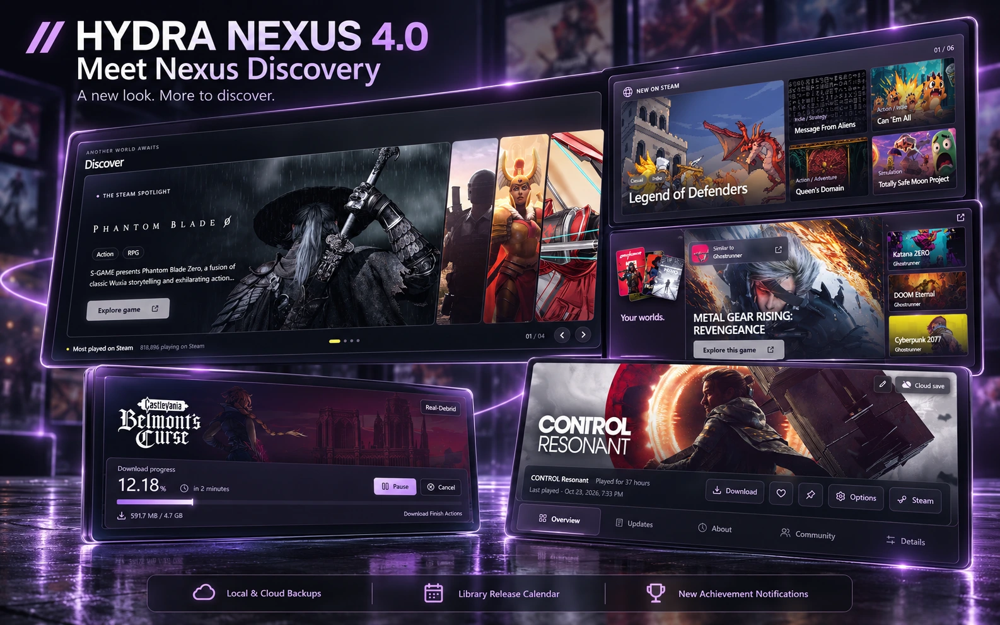

[English](https://github.com/M0KA40/Hydra-Nexus/blob/v4.0/docs/releases/4.0/en.md) · [Português (Brasil)](https://github.com/M0KA40/Hydra-Nexus/blob/v4.0/docs/releases/4.0/pt-BR.md) · [Español](https://github.com/M0KA40/Hydra-Nexus/blob/v4.0/docs/releases/4.0/es.md) · [Русский](https://github.com/M0KA40/Hydra-Nexus/blob/v4.0/docs/releases/4.0/ru.md) · [العربية](https://github.com/M0KA40/Hydra-Nexus/blob/v4.0/docs/releases/4.0/ar.md) · [Français](https://github.com/M0KA40/Hydra-Nexus/blob/v4.0/docs/releases/4.0/fr.md) · [Deutsch](https://github.com/M0KA40/Hydra-Nexus/blob/v4.0/docs/releases/4.0/de.md) · [Türkçe](https://github.com/M0KA40/Hydra-Nexus/blob/v4.0/docs/releases/4.0/tr.md) · [Polski](https://github.com/M0KA40/Hydra-Nexus/blob/v4.0/docs/releases/4.0/pl.md)

<!-- HYDRA_NEXUS_REVISION 1 -->

# Hydra Nexus 4.0

يقدّم هذا التحديث **Nexus Discovery** بحلّة جديدة، تحافظ على أساس تجربة Hydra الأصلية، مع إعادة تصميم واسعة لصفحاتها وتفاصيلها لتصبح أكثر جمالًا وتفاعلًا.

## واجهة Nexus Discovery
- **الصفحة الرئيسية:** إعادة تصميم بطابع سينمائي، مع سلايدر يستعرض أربعًا من أكثر الألعاب نشاطًا من حيث عدد اللاعبين المتزامنين على Steam. أقسام تفاعلية مرتبطة ببيانات Steam لاكتشاف الألعاب ومتابعة جديدها من مكان واحد، مع تحسين الصور والتنقّل لتصبح الرئيسية مساحة أكثر إلهامًا لاكتشاف لعبتك القادمة.
- **الكتالوج:** تحسين ترتيب الألعاب وعرضها ليصبح التصفّح أوضح وأكثر تناسقًا مع الواجهة الجديدة.
- **المكتبة:** تحسين المظهر وإضافة تأثير زجاجي خفيف عند تمرير المؤشر فوق أغلفة الألعاب.
- **صفحة اللعبة:** تحسين التصميم وتنظيم المحتوى ضمن أقسام مستقلة، وإضافة قسم للتحديثات مرتبط بأخبار المطوّرين على Steam لمتابعة المستجدات وملاحظات التحديث. سيحصل القسم على مزيد من التحسينات لاحقًا.
- **التنزيلات:** إعادة تصميم الصفحة وتحسين عرض اللعبة ومعلومات التقدّم لتصبح التجربة أوضح وأكثر حيوية.

## نشاط اللعب وإحصائيات الألعاب
- إعادة تصميم Play Activity لتجربة أكثر جمالًا وتفاعلًا.
- تحسين عرض وقت اللعب والألعاب والأيام النشطة والجلسات، مع التنقّل بين الفترات.
- تحديث إحصائيات كل لعبة وإضافة تفاصيل الأيام والجلسات ووقت اللعب، وتحسين الحركة والانتقال لتنسجم مع Discovery.
- إعادة تصميم إشعارات الملخّص الأسبوعي والشهري، مع صور ألعاب الفترة وألوان تتناسب مع الثيم المستخدم.

## النسخ الاحتياطي المحلي والسحابي
- إعادة النسخ الاحتياطي المحلي، مع استخدام الحفظ المحلي أو السحابي أو كليهما.
- تحسين إدارة النسخ الاحتياطية وعرض حالتها.
- الحفاظ على مراجعة الملفات والوجهات والتحقق من سلامة النسخ قبل الاستعادة، مع تأكيد الاستبدال وحماية الملفات المتأثرة بنسخ أمان.

## تقويم إصدارات المكتبة
- إضافة Release Calendar اختياريًا من إعدادات إضافات Nexus، والوصول إليه مباشرة من المكتبة.
- عرض الإصدارات القادمة والسابقة على أيام الشهر وتجميع الألعاب التي تشترك في موعد الإصدار.
- أغلفة داخل التقويم مع فتح صفحة اللعبة مباشرة.
- تحسين قراءة التواريخ وتحديثها واستخدام البيانات المحفوظة عند تعذّر جلب الجديد.
- المواعيد غير النهائية، مثل سنة فقط أو سيُعلن لاحقًا، ضمن قائمة منفصلة دون افتراض تاريخ غير مؤكد.

## إشعارات الإنجازات
- تصميم Nexus Discovery بإحساس بصري وحركة جديدين، للإنجازات العادية والمخفية والنادرة والبلاتينية.
- تجربة الإشعار من الإعدادات دون فتح إنجازات أو تغيير سجلها.
- اختيار Nexus أو تصميم Hydra الأصلي، مع تخصيص الصوت وفصل صوت Nexus الافتراضي عن صوت Hydra الأصلي.
- تحسين استجابة التجربة وحالات الانتظار والخطأ. المزيد من التصاميم وخيارات الصوت مخطط لها لاحقًا.

## مثبّت Nexus 4.0
- تحديث واجهة المثبّت ولانشر التحديث بألوان Nexus، مع تحسين الخطوط والأزرار والأيقونة.
- اكتشاف مسار Hydra تلقائيًا وإتاحة تحديده يدويًا عند الحاجة.
- تثبيت Nexus وإزالة Nexus، مع دعم التحديث وإصلاح التثبيت الموجود.
- تحسين إغلاق Hydra قبل العملية وإعادة تشغيله بعد نجاحها، ثم إغلاق المثبّت تلقائيًا.

هذه بداية جديدة لواجهة Nexus Discovery، وما زال أمامها المزيد من التطوير والتحسين. عملت على تفاصيلها لفترة طويلة، وأتمنى أن تستمتعوا باستكشافها بقدر ما استمتعت ببنائها.

شاركوني تجاربكم واقتراحاتكم، ويمكنكم إضافتي كصديق على Hydra من الزر داخل صفحة Nexus في الإعدادات. شكرًا لكل من شارك ملاحظاته واقتراحاته وساهم في تحسين المشروع.

**معًا لجعل Hydra المكان المثالي للاعبين.**
