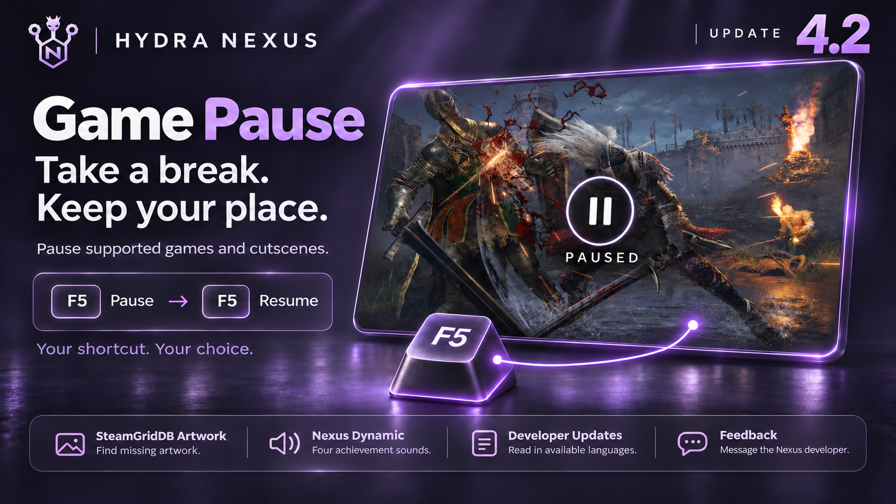

[English](https://github.com/M0KA40/Hydra-Nexus/blob/main/docs/releases/4.2/en.md) · [Português (Brasil)](https://github.com/M0KA40/Hydra-Nexus/blob/main/docs/releases/4.2/pt-BR.md) · [Español](https://github.com/M0KA40/Hydra-Nexus/blob/main/docs/releases/4.2/es.md) · [Русский](https://github.com/M0KA40/Hydra-Nexus/blob/main/docs/releases/4.2/ru.md) · [العربية](https://github.com/M0KA40/Hydra-Nexus/blob/main/docs/releases/4.2/ar.md) · [Français](https://github.com/M0KA40/Hydra-Nexus/blob/main/docs/releases/4.2/fr.md) · [Deutsch](https://github.com/M0KA40/Hydra-Nexus/blob/main/docs/releases/4.2/de.md) · [Türkçe](https://github.com/M0KA40/Hydra-Nexus/blob/main/docs/releases/4.2/tr.md) · [Polski](https://github.com/M0KA40/Hydra-Nexus/blob/main/docs/releases/4.2/pl.md)

# Hydra Nexus 4.2 — Notes de mise à jour

De nouvelles fonctions pour mieux garder le contrôle, des sons de succès distinctifs et une expérience plus soignée dans Hydra Nexus.

## Game Pause

Faites une pause et reprenez exactement où vous en étiez. Mettez en pause les jeux solo compatibles, y compris les cinématiques, même lorsque le jeu ne propose pas cette option. Appuyez sur **F5** pour suspendre le jeu, puis à nouveau pour reprendre, même depuis une autre fenêtre. Vous pouvez aussi personnaliser le raccourci selon vos préférences.

**Réservé aux jeux solo compatibles. Ne l’utilisez pas dans les jeux en ligne ni dans les jeux dotés d’un système anti-triche.**

## SteamGridDB Artwork

Plus de possibilités pour personnaliser votre bibliothèque. Associez la clé API de votre compte **SteamGridDB** pour retrouver les résultats d’images manquants dans la rubrique **Personnalisation** de Hydra, notamment **Icon, Logo, Library Hero et Cover**. Choisissez parmi les images disponibles sur le site et donnez à chaque jeu l’apparence qui vous convient.

## Nexus Dynamic — Sons des succès

À chaque succès son propre son. Nexus Dynamic propose des sons dédiés aux succès **normaux, cachés, rares (Rare) et de platine (Platinum)**, adaptés au moment et au type de succès obtenu. Vous pouvez les écouter dans les paramètres des notifications de succès. Le son précédent reste disponible sous le nom **Nexus Legacy**.

## Gestion des sons personnalisés

Ajoutez vos sons préférés, choisissez celui à utiliser et supprimez ceux dont vous n’avez plus besoin dans une liste plus claire et plus simple à gérer.

## Publications des développeurs — Updates

Suivez l’actualité et les mises à jour des développeurs de chaque jeu dans une présentation plus claire et mieux organisée. Les publications proposent désormais les langues fournies par le développeur et prises en charge par Hydra Nexus. Elles s’affichent dans la langue de l’interface lorsqu’elle est disponible, et vous pouvez choisir parmi les langues proposées pour chaque publication.

## Feedback — Contact direct

Une rubrique dédiée vous permet d’envoyer vos messages directement au développeur de Hydra Nexus. Partagez vos suggestions, vos idées pour de futures fonctions et vos remarques sur l’outil.

## Amélioration des traductions

Les traductions des langues prises en charge ont été affinées, avec des formulations plus claires et une terminologie plus cohérente dans toute l’interface.

## Un installateur plus léger et des améliorations générales

Les fichiers d’installation ont été réorganisés, nettoyés et compressés pour ramener la taille de l’installateur à environ la moitié de sa taille précédente. Cette version apporte également des améliorations de l’interface et diverses corrections de bugs.
